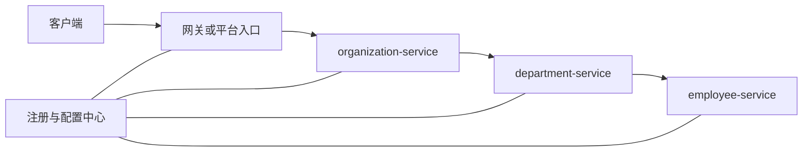
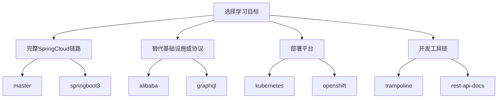

# Spring Cloud 微服务示例集

本仓库把原项目不同历史分支整理为 `demos/` 下的独立快照，便于在同一处比较 Spring Cloud 的不同技术路线。每个目录都是一个自包含的 Maven 多模块项目，应进入对应目录后单独构建，不要在仓库根目录聚合构建。

## 这些 Demo 在解决什么问题

示例共享同一个业务场景：一个组织（Organization）拥有多个部门（Department），一个部门拥有多名员工（Employee）。简单查询由单个服务完成，聚合查询则需要服务间调用。



各 demo 保持相近的领域模型，但分别替换注册发现、配置、网关、通信协议、部署平台或 API 文档方案。因此，读者可以把注意力集中在某项基础设施变化带来的实现差异上。

## Demo 导航

| Demo | 主要目标 | 核心技术 | 推荐读者 |
| --- | --- | --- | --- |
| [master](demos/master/readme.md) | 学习当前主线的完整微服务调用链 | Config Server、Eureka、Spring Cloud Gateway、OpenFeign、Springdoc、Zipkin | 希望先跑通完整示例 |
| [springboot3](demos/springboot3/readme.md) | 理解 Boot 3 时代的追踪与 API 文档 | Spring Boot 3、Micrometer Tracing、OpenTelemetry、Springdoc | 维护 Boot 3 项目的读者 |
| [alibaba](demos/alibaba/readme.md) | 用 Nacos 同时承担注册与配置 | Nacos、Zuul、OpenFeign | 关注 Spring Cloud Alibaba |
| [graphql](demos/graphql/readme.md) | 比较 GraphQL 与 REST 的跨服务查询 | GraphQL Java Tools、Apollo Client、Eureka | 评估 GraphQL 服务化 |
| [kubernetes](demos/kubernetes/readme.md) | 了解微服务部署到 Kubernetes 的基本资源关系 | Kubernetes、Ingress、MongoDB、Zuul | 学习容器编排 |
| [openshift](demos/openshift/readme.md) | 了解 OpenShift Source-to-Image 发布流程 | OpenShift S2I、MongoDB、OpenFeign | 使用 OpenShift 的读者 |
| [trampoline](demos/trampoline/readme.md) | 在本机统一管理多个 Spring Boot 进程 | Trampoline、Eureka、Config、Gateway/Zuul | 经常本地联调多服务 |
| [rest-api-docs](demos/rest-api-docs/readme.md) | 比较测试驱动文档与运行时文档 | Spring REST Docs、Asciidoctor、Springfox | 设计 API 文档流程 |



## 推荐阅读顺序

1. 从 `master` 理解配置中心、服务发现、网关和服务间调用。
2. 阅读 `springboot3`，观察版本升级以及可观测性实现的变化。
3. 根据兴趣选择 Nacos、GraphQL、Kubernetes/OpenShift 或文档工具链示例。
4. 每个 README 都包含目标、架构图、关键实现、启动方法、验证步骤与已知限制。

## 快速开始

当前主线提供 Docker Compose 编排：

```shell
cd demos/master
docker compose up --build
```

启动后可访问：

- Gateway：<http://localhost:8060>
- Eureka：<http://localhost:8061>
- Config Server：<http://localhost:8088>
- Zipkin：<http://localhost:9411>

停止并清理容器：

```shell
docker compose down
```

其他历史 demo 可能依赖 Nacos、Kubernetes、OpenShift、Trampoline 或旧版 JDK。请先阅读其 README 中的“前置条件”和“已知限制”，不要假设所有目录都支持 Docker Compose。
