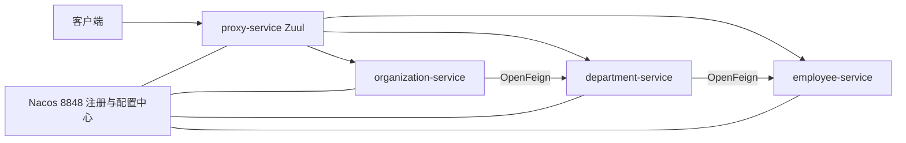
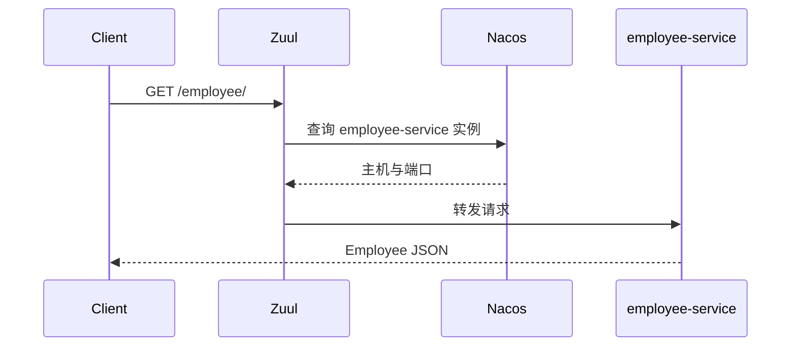

# Spring Cloud Alibaba：Nacos 微服务示例

## Demo 目标

本示例展示如何用一个 Nacos 实例同时替代 Eureka 和 Config Server：

- 四个应用向 Nacos 注册；
- 各应用从 Nacos 读取外部配置；
- Zuul 根据 Nacos 中的 service ID 转发请求；
- Organization 和 Department 使用 OpenFeign 完成聚合查询。

这是基于 Spring Boot 2.0、Spring Cloud Finchley 和 Spring Cloud Alibaba 0.2.0.RELEASE 的历史示例，适合学习设计思路，不应直接作为新项目依赖版本。

## 架构



## 为什么使用 Nacos

在经典 Spring Cloud 架构中，注册发现和配置管理通常由 Eureka 与 Config Server 分别承担。本示例让 Nacos 同时提供这两项能力，减少基础设施组件数量。应用在 `bootstrap.yml` 中配置同一个 `localhost:8848`：

```yaml
spring:
  cloud:
    nacos:
      config:
        server-addr: localhost:8848
      discovery:
        server-addr: localhost:8848
```

## 模块与实现

| 模块 | 作用 | 关键点 |
| --- | --- | --- |
| `employee-service` | 员工查询 | 注册到 Nacos |
| `department-service` | 部门查询、聚合员工 | OpenFeign 调 employee |
| `organization-service` | 组织查询、聚合部门 | OpenFeign 调 department |
| `proxy-service` | 统一入口 | `@EnableZuulProxy`、Swagger 聚合 |

`proxy-service/src/main/resources/bootstrap.yml` 定义三条 Zuul 路由。例如 `/employee/**` 对应 `employee-service`。Zuul 不保存员工服务的地址，而是根据 service ID 向 Nacos 查询可用实例。



## 运行

### 前置条件

- 与该历史技术栈兼容的 JDK 和 Maven；
- 本机运行 Nacos，控制台和服务端口为 `8848`；
- 本目录没有 Docker Compose 编排，需要自行准备 Nacos。

先启动 Nacos，再在不同终端启动服务：

```shell
cd employee-service && mvn spring-boot:run
cd department-service && mvn spring-boot:run
cd organization-service && mvn spring-boot:run
cd proxy-service && mvn spring-boot:run
```

业务应用可并行启动；发起聚合查询前，应确保 employee → department → organization 均已在 Nacos 注册。应用端口可能来自 Nacos 配置，请以控制台实例列表和启动日志为准。

## 验证

1. 打开 Nacos 控制台，确认 `employee-service`、`department-service`、`organization-service` 和 `proxy-service` 均在线。
2. 在 Nacos 配置列表确认应用需要的数据配置已经创建；仓库只保存连接 Nacos 的 bootstrap 配置，不包含服务端数据。
3. 从 `proxy-service` 的实际端口访问：

   ```shell
   curl http://localhost:<proxy-port>/employee/
   curl http://localhost:<proxy-port>/organization/
   ```

4. 停止某个业务服务，观察 Nacos 实例状态变化以及 Zuul 调用结果。

## 阅读代码的建议

1. 从四个模块的 `bootstrap.yml` 理解 Nacos 客户端配置。
2. 查看 `ProxyApplication` 的 `@EnableZuulProxy` 和 `proxy-service` 的路由定义。
3. 查看 organization、department 下的 Feign Client，理解服务名调用。
4. 与 [`master`](../master/readme.md) 对比：Nacos 替代 Config Server + Eureka，Zuul 则对应主线中的 Spring Cloud Gateway。

## 已知限制

- 依赖版本较旧，可能不兼容当前 JDK；
- 没有一键基础设施脚本，Nacos 配置需手动准备；
- Zuul 1 已进入维护历史，新项目通常选择 Spring Cloud Gateway。

## 延伸阅读

- [Microservices with Spring Cloud Alibaba](https://piotrminkowski.com/2018/11/15/microservices-with-spring-cloud-alibaba/)
- 返回[示例总览](../../README.md)
