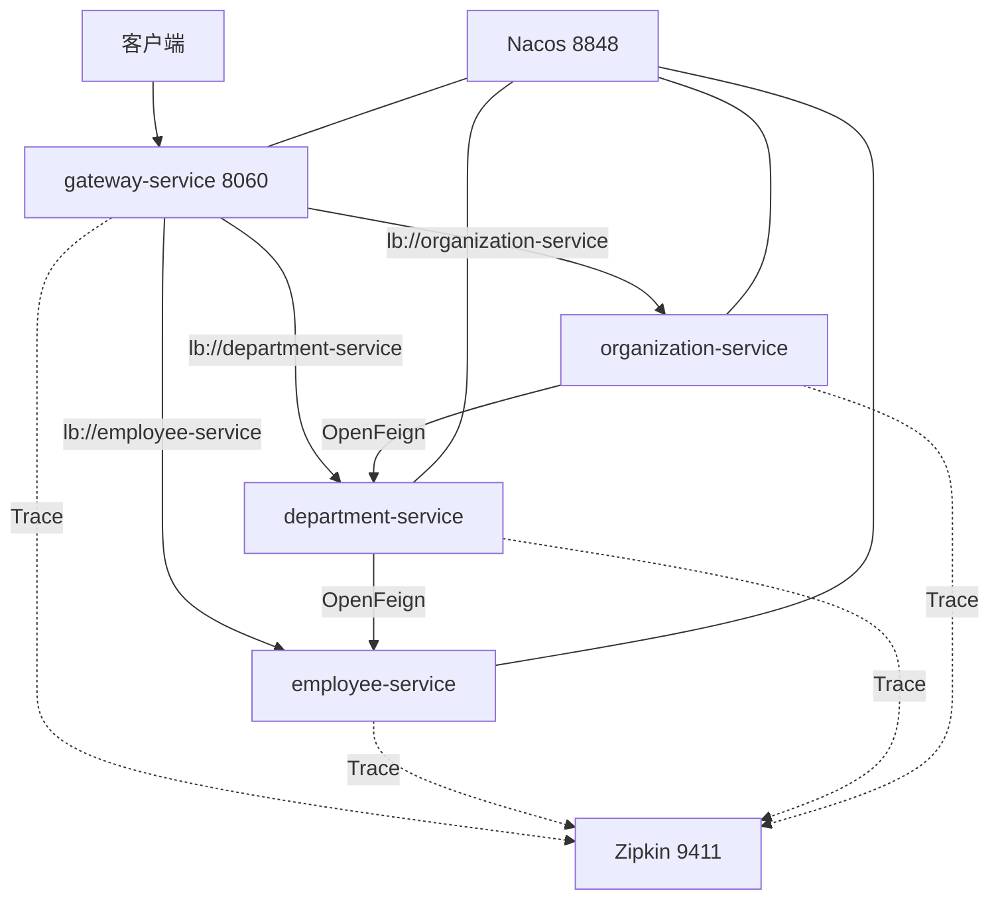

# Spring Cloud Alibaba：Nacos 微服务示例

## Demo 目标

本示例回答的是：**把 master 里的 Eureka + Config Server 换成 Nacos 做服务发现后，Gateway 和 OpenFeign 是否仍能按服务名走通同一条业务调用链。**

要验证的几件事：

1. **Nacos 是注册中心，不是 Eureka**：四个应用出现在 Nacos 服务列表里。
2. **配置在各服务自己的 `application.yml`**：没有 Config Server，也没有 `bootstrap.yml`。
3. **网关仍用 `lb://`**：`/employee`、`/department`、`/organization` 前缀转发到 Nacos 中的实例。
4. **Feign 聚合不变**：`GET /organization/1/with-departments-and-employees` 与 master 返回同类嵌套 JSON。

代码已对齐 **Java 25、Spring Boot 4.1.1、Spring Cloud 2025.1.3、Spring Cloud Alibaba 2025.1.0.0**，不再使用 Zuul。

## 架构



## 与 master 的差异

| 项目 | alibaba | master |
| --- | --- | --- |
| 注册发现 | Nacos | Eureka |
| 配置 | 各服务 `application.yml` | Config Server |
| 网关 | Spring Cloud Gateway + Nacos | 同左 + Eureka |
| Compose 基础设施 | `nacos` + `zipkin` | `config-service` + `discovery-service` + `zipkin` |

## 模块

| 模块 | 作用 | Compose 宿主机端口 |
| --- | --- | --- |
| `gateway-service` | 统一入口、OpenAPI 聚合 | 8060 |
| `employee-service` | 员工服务 | 8080 |
| `department-service` | 部门服务，Feign 调 employee | 8081 |
| `organization-service` | 组织服务，Feign 调 department | 8082 |

Nacos 控制台 8848，Zipkin 9411。

## 运行方式

### 前置条件

- Docker 与 Docker Compose 插件；
- 本地 Maven 需要 JDK 25，且三个业务服务默认都是 8080，必须改端口。

工作目录：`demos/alibaba`。

### 推荐：Docker Compose

```shell
docker compose up --build
```

Nacos 健康检查通过后才会启动业务容器。停止：

```shell
docker compose down
```

### 本地 Maven

先起基础设施：

```shell
docker compose up -d nacos zipkin
```

再在不同终端启动（不要开 `docker` profile，否则会去解析主机名 `nacos`）：

```shell
cd employee-service && mvn spring-boot:run
cd department-service && mvn spring-boot:run -Dspring-boot.run.arguments=--server.port=8081
cd organization-service && mvn spring-boot:run -Dspring-boot.run.arguments=--server.port=8082
cd gateway-service && mvn spring-boot:run
```

## 验证

### 1. Nacos 中已注册四个服务

打开 <http://localhost:8848/nacos>（Compose 关闭了鉴权，无需登录）。进入 **服务管理 → 服务列表**，应看到 `gateway-service`、`employee-service`、`department-service`、`organization-service`，实例状态健康。

这一步用来证明发现走的是 Nacos，而不是 Eureka（本目录没有 `discovery-service`，也没有 8061 端口）。

### 2. 经网关访问单个服务

```shell
curl http://localhost:8060/employee/
curl http://localhost:8060/department/
curl http://localhost:8060/organization/
```

员工列表应含 `John Smith`；组织列表应含 `Microsoft`、`Oracle`。说明 Gateway 的 `lb://` 已从 Nacos 解析到实例。

若返回 503，通常是网关启动早于实例注册，稍等再试。

### 3. 跨服务聚合（与 master 同一业务路径）

```shell
curl http://localhost:8060/organization/1/with-departments-and-employees
```

**通过标准：** 顶层 `name` 为 `Microsoft`，`departments` 含 Development / Operations，部门内嵌员工。可选对照：

```shell
curl http://localhost:8060/department/organization/1/with-employees
```

应返回组织 1 的两个部门，且各部门带员工。

### 4. OpenAPI 与追踪（可选，证明其余栈仍在）

- <http://localhost:8060/swagger-ui/index.html> 可切换三个业务服务。
- 再打一次聚合请求后打开 <http://localhost:9411>，应能按服务名找到 Trace。

## 已知限制

- Nacos **只做发现**，本示例没有接入 Nacos 配置中心。
- 网关 Compose 未等待业务实例注册，刚启动可能 503。
- 本地三个业务服务默认端口都是 8080，不改端口会冲突。
- Zipkin 不是硬依赖：未启动时 HTTP 仍可用，只是没有 Trace。

## 延伸阅读

- 对照 Eureka 版本：[master](../master/readme.md)
- 返回[示例总览](../../README.md)
