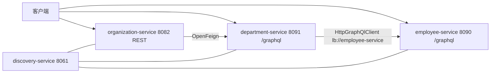
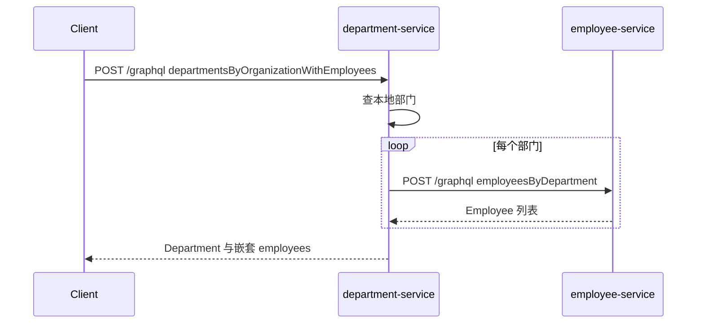

# GraphQL 微服务示例（Spring for GraphQL）

## Demo 目标

本示例回答的是：**跨服务查询能否用 GraphQL 替代 REST + OpenFeign，以及 GraphQL 与 REST 如何在同一套领域模型里并存。**

要验证的几件事：

1. **Employee 对外是 GraphQL**：`POST /graphql` 能按 schema 查询员工，而不是 `GET /employee/`。
2. **Department 用 GraphQL 调 Employee**：`departmentsByOrganizationWithEmployees` 通过 `HttpGraphQlClient` + LoadBalancer 访问 Eureka 中的 `employee-service`，而不是手写 `localhost` URL。
3. **Organization 仍是 REST + OpenFeign**：演示混合架构；本 Demo 的核心验收以 GraphQL 路径为准。
4. **没有 Gateway / Config Server**：客户端直连各服务端口。

技术栈：**Java 25、Spring Boot 4.1.1、Spring Cloud 2025.1.3**。

## 架构



跨服务 GraphQL 查询：



## 模块

| 模块 | 对外协议 | 端口 |
| --- | --- | --- |
| `discovery-service` | Eureka UI | 8061 |
| `employee-service` | GraphQL（GraphiQL 已开） | 8090 |
| `department-service` | GraphQL（GraphiQL 已开） | 8091 |
| `organization-service` | REST | 8082 |

阅读顺序：`employee.graphqls` → `EmployeeGraphController` → `department.graphqls` → `DepartmentGraphController` → `EmployeeGraphClient`。

## 运行方式

### 前置条件

- JDK 25 与 Maven。
- 本目录**没有** Docker Compose，必须本地多终端启动。

工作目录：`demos/graphql`。

```shell
cd discovery-service && mvn spring-boot:run
cd employee-service && mvn spring-boot:run
cd department-service && mvn spring-boot:run
cd organization-service && mvn spring-boot:run   # 可选，混合架构
```

必须先等 Eureka 里出现 `EMPLOYEE-SERVICE`，再测 Department 的跨服务 query。

## 验证

### 1. Eureka 中已注册 GraphQL 服务

打开 <http://localhost:8061>。至少应有 `EMPLOYEE-SERVICE`、`DEPARTMENT-SERVICE`。若还启动了 Organization，应同时有 `ORGANIZATION-SERVICE`。

### 2. Employee GraphQL（本服务内查询）

```shell
curl -sS -X POST http://localhost:8090/graphql \
  -H 'Content-Type: application/json' \
  -d '{"query":"{ employees { id name position departmentId } }"}'
```

**通过标准：** JSON 在 `data.employees` 下返回约 10 名员工，含 `John Smith`。浏览器也可打开 <http://localhost:8090/graphiql> 跑同一 query。

再按部门过滤：

```shell
curl -sS -X POST http://localhost:8090/graphql \
  -H 'Content-Type: application/json' \
  -d '{"query":"query($d: ID!) { employeesByDepartment(departmentId: $d) { id name position } }","variables":{"d":"1"}}'
```

部门 1 应返回 3 人。

### 3. 本 Demo 重点：Department 跨服务拉员工

```shell
curl -sS -X POST http://localhost:8091/graphql \
  -H 'Content-Type: application/json' \
  -d '{"query":"{ departmentsByOrganizationWithEmployees(organizationId: \"1\") { id name employees { id name position } } }"}'
```

**通过标准：**

- `data.departmentsByOrganizationWithEmployees` 有两个部门（Development、Operations）。
- Development 的 `employees` 非空（约 3 人，含 `John Smith`）。
- Department 日志中应出现对 `employee-service` 的 GraphQL 调用。若此处失败而步骤 2 成功，说明 Eureka / LoadBalancer 未解析到 `http://employee-service`。

GraphiQL：<http://localhost:8091/graphiql>。

注意：`department(id)` 的 schema 虽有 `employees` 字段，但**没有**字段级 resolver；只有 `departmentsByOrganizationWithEmployees` 会填充员工。用 `department(id: "1") { employees { name } }` 得到空列表并不代表跨服务失败。

### 4. 混合架构（可选）

```shell
curl -sS http://localhost:8082/
```

应返回 `Microsoft`、`Oracle`。Organization 的 `/{id}/with-departments-and-employees` 走 Feign REST，Employee 当前只暴露 GraphQL，该聚合**不是**本 Demo 的验收项。

## 已知限制

- 无 Gateway、无 Config Server、无 Compose。
- 目录里仍有历史 Apollo resolver 等文件，运行时以 `*GraphController` 与 `*.graphqls` 为准。
- Department schema 的 `employees` 字段只在聚合 query 中填充。
- Organization REST + Feign 假定下游仍是 REST，与 Employee 的 GraphQL 入口不完全对齐。

## 延伸阅读

- 对照 REST 主线：[master](../master/readme.md)
- 返回[示例总览](../../README.md)
