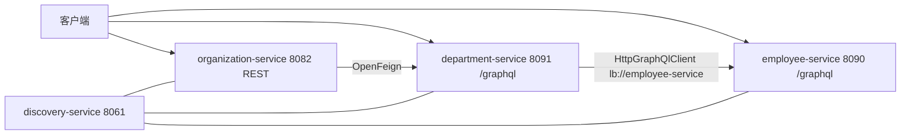
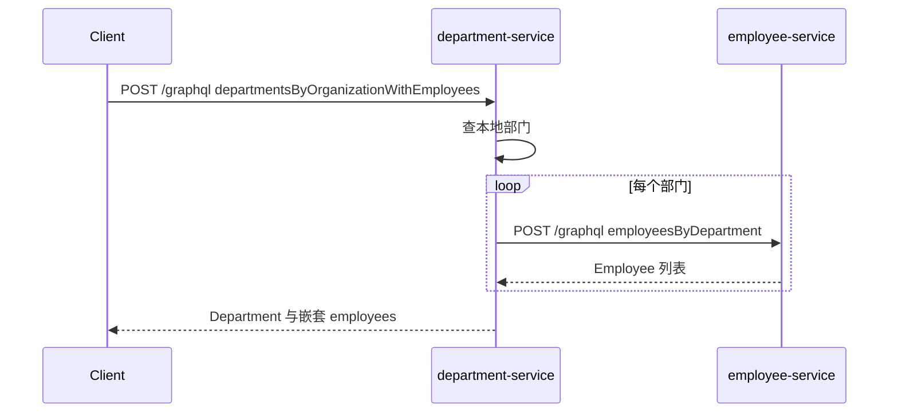
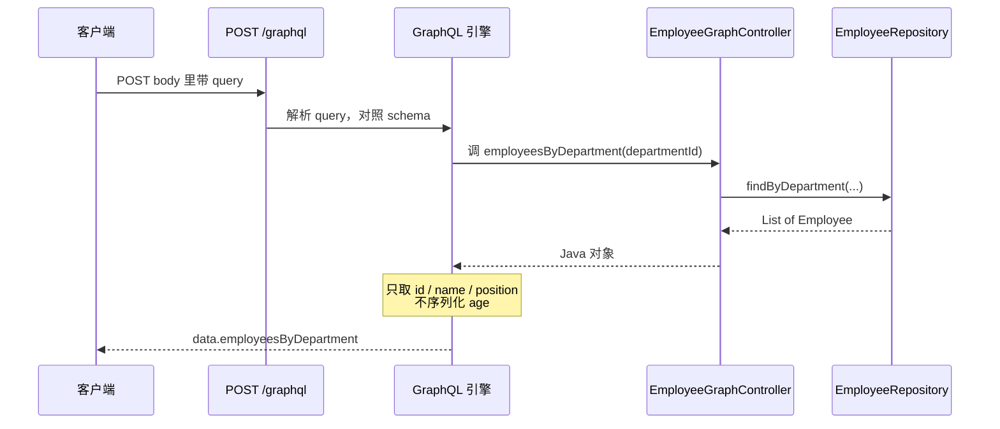

# GraphQL 微服务示例（Spring for GraphQL）

## Demo 目标

本示例回答的是：**跨服务查询能否用 GraphQL 替代 REST + OpenFeign，以及 GraphQL 与 REST 如何在同一套领域模型里并存。**

要验证的几件事：

1. **Employee 对外是 GraphQL**：`POST /graphql` 能按 schema 查询员工，而不是 `GET /employee/`。
2. **Department 用 GraphQL 调 Employee**：`departmentsByOrganizationWithEmployees` 通过 `HttpGraphQlClient` + LoadBalancer 访问 Eureka 中的 `employee-service`，而不是手写 `localhost` URL。
3. **Organization 仍是 REST + OpenFeign**：演示混合架构；本 Demo 的核心验收以 GraphQL 路径为准。
4. **没有 Gateway / Config Server**：客户端直连各服务端口。

技术栈：**Java 25、Spring Boot 4.1.1、Spring Cloud 2025.1.3**。

## 架构



跨服务 GraphQL 查询：



## 模块

| 模块 | 对外协议 | 端口 |
| --- | --- | --- |
| `discovery-service` | Eureka UI | 8061 |
| `employee-service` | GraphQL（GraphiQL 已开） | 8090 |
| `department-service` | GraphQL（GraphiQL 已开） | 8091 |
| `organization-service` | REST | 8082 |

阅读顺序：`employee.graphqls` → `EmployeeGraphController` → `department.graphqls` → `DepartmentGraphController` → `EmployeeGraphClient`。

## GraphQL 服务端是如何实现的

GraphQL 服务端在本 Demo 里就是：**一个 HTTP 入口 + 一份 schema + 一组按名字对上的 Java 方法**。没有多套 REST 路径。

### 和 REST 的差别

REST 是「一个 URL 对应一个接口」：

- `GET /employees`
- `GET /employees/{id}`
- `GET /employees/department/{id}`

GraphQL 反过来：**永远只打一个地址** `POST /graphql`，真正查什么写在请求体的 query 里。Spring 根据 query 里的字段名，去调对应的 Java 方法。

```http
POST http://localhost:8090/graphql
Content-Type: application/json

{ "query": "{ employees { id name position } }" }
```

客户端自己决定要哪些字段。服务端不会因为少要一个 `age` 就再开一个接口。

### 服务端只做了三件事

**1. 依赖把 `/graphql` 自动挂上**

`employee-service` 的 `pom.xml` 有 `spring-boot-starter-graphql`。启动后 Spring 自动提供：

- `POST /graphql`：真正的协议入口
- GraphiQL（`application.yml` 里 `spring.graphql.graphiql.enabled: true`）：浏览器调试页，地址是 <http://localhost:8090/graphiql>

不需要自己写 Servlet，也不需要注册路由。

**2. Schema 定义「能查什么」**

契约在 `employee-service/src/main/resources/graphql/employee.graphqls`：

```graphql
type Query {
  employees: [Employee]
  employee(id: ID!): Employee
  employeesByOrganization(organizationId: ID!): [Employee]
  employeesByDepartment(departmentId: ID!): [Employee]
}

type Employee {
  id: ID
  organizationId: ID
  departmentId: ID
  name: String
  age: Int
  position: String
}
```

约定：顶层能查 4 个 query，返回的 `Employee` 有哪些字段。Spring Boot 约定文件放在 `src/main/resources/graphql/*.graphqls`，启动时自动加载。这是契约，不是实现。

**3. Controller 按名字对上 schema**

`EmployeeGraphController` 用 `@Controller` + `@QueryMapping`，不是 `@RestController`，也没有 `@GetMapping`。`@QueryMapping` 的意思是：「这个方法负责 schema 里某个 Query 字段」。

绑定规则：

| Schema | Java |
| --- | --- |
| `type Query { employees }` | `@QueryMapping` 方法名 `employees()` |
| `employee(id: ID!)` | `@QueryMapping employee(@Argument Long id)` |
| `type Employee { name }` | `Employee.getName()` |

返回的是普通 Java 对象。GraphQL 引擎再按客户端要的字段去调 getter，组装 JSON。你返回了完整 `Employee`，客户端只写 `{ id name }`，响应里就只有这两项。

同一套 `EmployeeRepository`，REST 版是多个路径，GraphQL 版只是把路径换成了 schema 字段名。业务代码（查内存仓库）完全一样；变的是入口形状：一个 endpoint + 一份 schema。

### 一次请求在服务端怎么走

以这条为例：

```graphql
query($d: ID!) {
  employeesByDepartment(departmentId: $d) {
    id
    name
    position
  }
}
```



分两层：

1. **Query 层**：`employeesByDepartment` 要对上一个 `@QueryMapping` 方法。对不上，启动或请求会报 schema 绑定错误。
2. **Type 层**：`Employee` 的 `id`、`name` 默认走 getter，**不需要再写 resolver**。只有字段不能从对象上直接取时，才写 `@SchemaMapping`。

所以服务端实现 = 「顶层 query 你手写，对象字段 Spring 按 JavaBean 自动拆」。

### Department 作为 GraphQL 服务端也是同一套

`department-service` 同样：

1. `department.graphqls` 声明 `departmentsByOrganizationWithEmployees`
2. `DepartmentGraphController` 里同名 `@QueryMapping`

多出来的只是这个方法内部又当了 **GraphQL 客户端**，去调 employee-service 的 `/graphql`：查本地部门后，对每个部门调用 `EmployeeGraphClient.findByDepartment`，把员工填进 `Department.employees`。

对调用方来说，Department 仍然是 GraphQL 服务端；对 Employee 来说，Department 是客户端。协议两边都是 `POST /graphql`，只是角色不同。

### 容易绕进去的两点

- **`resolver/` 目录不用看。** 那是旧 Apollo 写法。运行时以 `*GraphController` 和 `*.graphqls` 为准。真正生效的是 `EmployeeGraphController` / `DepartmentGraphController`。
- **嵌套字段默认不会自动跨服务。** `department(id) { employees { name } }` 会得到空列表，因为 `department()` 只查了本地部门，没有填 `employees`。只有 `departmentsByOrganizationWithEmployees` 主动调了 `EmployeeGraphClient`。GraphQL 不会因为 schema 里写了 `employees: [Employee]` 就自己去别的服务拉数据。

可以记成一句话：**schema 是菜单，`@QueryMapping` 是后厨，`POST /graphql` 是唯一窗口。** 想查哪几个菜，客户端在 query 里点；服务端按字段名上菜，再按点的字段装盘。

## 运行方式

### 前置条件

- JDK 25 与 Maven。
- 本目录**没有** Docker Compose，必须本地多终端启动。

工作目录：`demos/graphql`。

```shell
cd discovery-service && mvn spring-boot:run
cd employee-service && mvn spring-boot:run
cd department-service && mvn spring-boot:run
cd organization-service && mvn spring-boot:run   # 可选，混合架构
```

必须先等 Eureka 里出现 `EMPLOYEE-SERVICE`，再测 Department 的跨服务 query。

## 验证

### 1. Eureka 中已注册 GraphQL 服务

打开 <http://localhost:8061>。至少应有 `EMPLOYEE-SERVICE`、`DEPARTMENT-SERVICE`。若还启动了 Organization，应同时有 `ORGANIZATION-SERVICE`。

### 2. Employee GraphQL（本服务内查询）

```shell
curl -sS -X POST http://localhost:8090/graphql \
  -H 'Content-Type: application/json' \
  -d '{"query":"{ employees { id name position departmentId } }"}'
```

**通过标准：** JSON 在 `data.employees` 下返回约 10 名员工，含 `John Smith`。浏览器也可打开 <http://localhost:8090/graphiql> 跑同一 query。

再按部门过滤：

```shell
curl -sS -X POST http://localhost:8090/graphql \
  -H 'Content-Type: application/json' \
  -d '{"query":"query($d: ID!) { employeesByDepartment(departmentId: $d) { id name position } }","variables":{"d":"1"}}'
```

部门 1 应返回 3 人。

### 3. 本 Demo 重点：Department 跨服务拉员工

```shell
curl -sS -X POST http://localhost:8091/graphql \
  -H 'Content-Type: application/json' \
  -d '{"query":"{ departmentsByOrganizationWithEmployees(organizationId: \"1\") { id name employees { id name position } } }"}'
```

**通过标准：**

- `data.departmentsByOrganizationWithEmployees` 有两个部门（Development、Operations）。
- Development 的 `employees` 非空（约 3 人，含 `John Smith`）。
- Department 日志中应出现对 `employee-service` 的 GraphQL 调用。若此处失败而步骤 2 成功，说明 Eureka / LoadBalancer 未解析到 `http://employee-service`。

GraphiQL：<http://localhost:8091/graphiql>。

注意：`department(id)` 的 schema 虽有 `employees` 字段，但**没有**字段级 resolver；只有 `departmentsByOrganizationWithEmployees` 会填充员工。用 `department(id: "1") { employees { name } }` 得到空列表并不代表跨服务失败。

### 4. 混合架构（可选）

```shell
curl -sS http://localhost:8082/
```

应返回 `Microsoft`、`Oracle`。Organization 的 `/{id}/with-departments-and-employees` 走 Feign REST，Employee 当前只暴露 GraphQL，该聚合**不是**本 Demo 的验收项。

## 已知限制

- 无 Gateway、无 Config Server、无 Compose。
- 目录里仍有历史 Apollo resolver 等文件，运行时以 `*GraphController` 与 `*.graphqls` 为准。
- Department schema 的 `employees` 字段只在聚合 query 中填充。
- Organization REST + Feign 假定下游仍是 REST，与 Employee 的 GraphQL 入口不完全对齐。

## 延伸阅读

- 对照 REST 主线：[master](../master/readme.md)
- 返回[示例总览](../../README.md)
