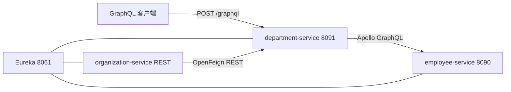
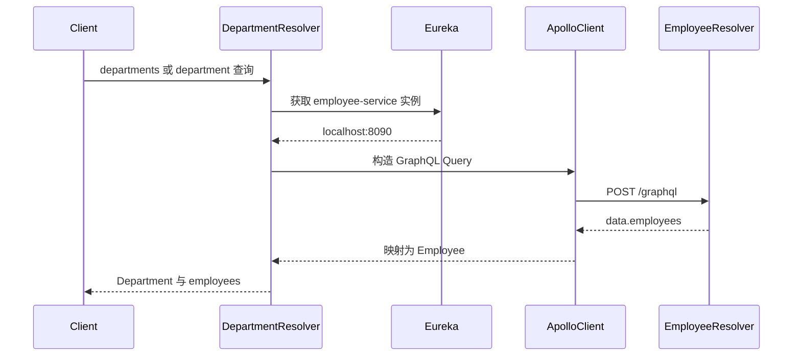

# GraphQL 微服务与 Apollo Client 示例

## Demo 目标

本示例探索 GraphQL 在微服务中的使用方式：

- Employee 和 Department 通过 `/graphql` 暴露查询；
- Resolver 把 GraphQL 字段映射为仓库查询；
- Department 使用 Apollo Client 调用 Employee 的 GraphQL API；
- Apollo 调用前通过 Eureka 选择 Employee 实例；
- Organization 保留 REST/OpenFeign，用于展示 REST 与 GraphQL 混合架构。

它是基于 Spring Boot 2.0 和早期 GraphQL Starter 的历史快照，重点是理解 schema、resolver 和跨服务查询，而不是提供现代 Spring for GraphQL 模板。

## 架构





## 核心概念

### Schema 定义 API

`employee-service/src/main/resources/graphql/employee.graphqls` 定义可查询字段和返回类型。相比固定 REST 响应，客户端可以只选择需要的字段：

```graphql
{
  employees {
    id
    name
    position
  }
}
```

### Resolver 实现查询

`EmployeeQueries` 实现 `GraphQLQueryResolver`，把 schema 中的查询委托给内存仓库。Department 采用相同模式，但在需要员工数据时创建 Apollo 查询。

### Eureka 解决目标地址

Apollo Client 本身不知道 Spring Cloud 的 service ID。`EmployeeClient` 先从 Eureka 获取 `employee-service` 实例，再构造 `http://host:port/graphql`。这展示了“服务发现 + GraphQL 客户端”的桥接方式。

## 模块

| 模块 | 接口类型 | 作用 |
| --- | --- | --- |
| `discovery-service` | Eureka | 服务注册中心，端口 8061 |
| `employee-service` | GraphQL | 员工查询，固定端口 8090 |
| `department-service` | GraphQL | 部门查询并通过 Apollo 获取员工，固定端口 8091 |
| `organization-service` | REST/OpenFeign | 历史混合实现，不是完整 GraphQL 服务 |

虽然 organization 目录中存在 `organization.graphqls`，但该模块没有对应 GraphQL starter 和 resolver 接线，因此不要把它视为可用的 Organization GraphQL 端点。

## 运行

### 前置条件与配置缺口

- 使用与 Spring Boot 2.0 依赖兼容的 JDK 和 Maven；
- 本目录没有 Docker Compose；
- `organization-service/bootstrap.yml` 仍指向 `http://localhost:8088` Config Server，但本 demo 没有 `config-service` 模块。只体验 Employee/Department GraphQL 时无需启动 Organization；若要运行它，需要额外提供兼容的 Config Server 或调整其配置。

按顺序在不同终端启动：

```shell
cd discovery-service && mvn spring-boot:run
cd employee-service && mvn spring-boot:run
cd department-service && mvn spring-boot:run
```

准备好外部 Config Server 后，才启动：

```shell
cd organization-service && mvn spring-boot:run
```

## 验证

查询 Employee：

```shell
curl -X POST http://localhost:8090/graphql \
  -H 'Content-Type: application/json' \
  -d '{"query":"{ employees { id name position } }"}'
```

预期响应位于 `data.employees`。再打开 <http://localhost:8061>，确认 Employee 和 Department 已注册。

Employee 模块包含 GraphiQL 和 Voyager starter。旧版 starter 的 UI 路径会受其版本配置影响，可先尝试：

- <http://localhost:8090/graphiql>
- <http://localhost:8090/voyager>

若 UI 未启用，使用上面的 `curl` 或任意 GraphQL 客户端访问 `/graphql`。

## 阅读顺序

1. 阅读 `graphql/*.graphqls`，先理解 API 契约。
2. 阅读 `EmployeeQueries` 和 `DepartmentQueries`，理解 resolver。
3. 阅读 `EmployeeClient`，跟踪 Eureka 发现、Apollo Query 和结果映射。
4. 对照 organization 的 REST Controller 和 Feign Client，比较两种通信方式。

## 已知限制

- `EmployeeApiTest` 中的历史测试 URL 使用 8080，与当前 bootstrap 的 8090 不一致；
- Organization 的 GraphQL schema 未接线；
- Organization 依赖仓库外的 Config Server；
- 依赖版本老旧，现代项目应评估 Spring for GraphQL 和更新的客户端。

## 延伸阅读

- [GraphQL – The Future of Microservices?](https://piotrminkowski.com/2018/08/16/graphql-the-future-of-microservices/)
- 返回[示例总览](../../README.md)
