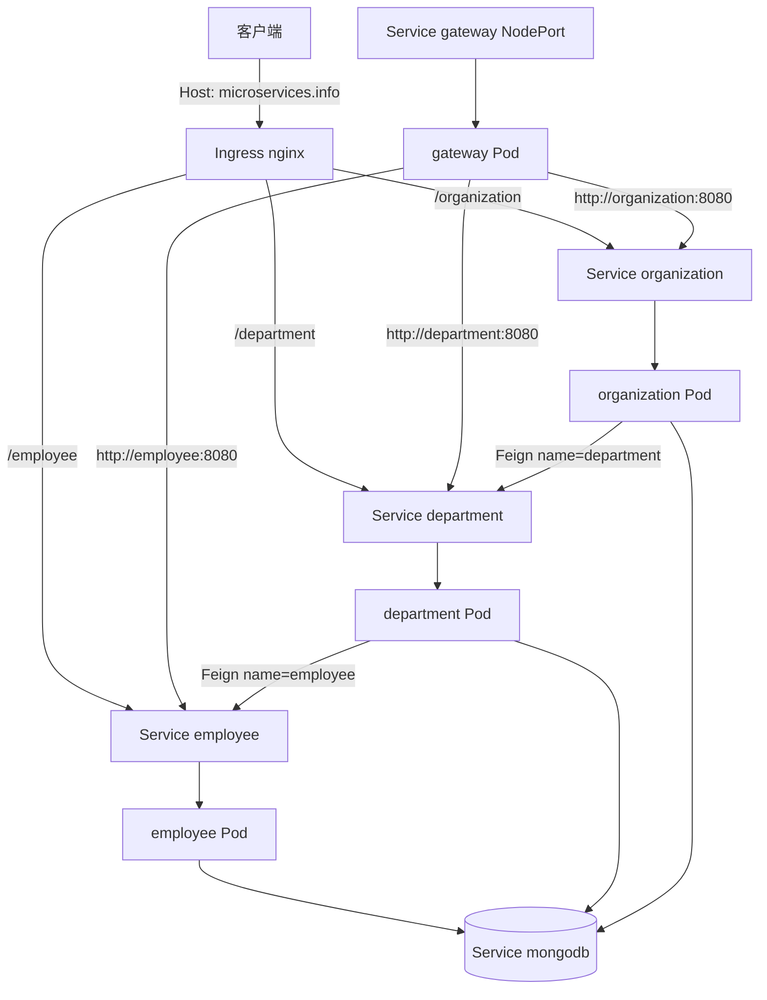

# Kubernetes 微服务部署示例

## Demo 目标

本示例回答的是：**没有 Eureka / Config Server 时，Kubernetes Service DNS、Ingress 和 Gateway 如何把三个业务服务连起来。** 数据在 MongoDB，不在内存仓库。

要验证的几件事：

1. **平台 DNS 替代注册中心**：Pod 通过 Service 名 `employee`、`department`、`organization`、`mongodb` 互访。
2. **Ingress 把外部前缀剥掉后打到业务 Service**（当前清单**不经过 Gateway**）。
3. **Gateway 用固定 URI `http://employee:8080` 等转发**：证明集群内服务名路由，而不是 `lb://` + Eureka。
4. **MongoDB 是空库**：必须先 POST 写入，再测查询；不能照搬 master 的 `organization/1/...`。

应用构建声明为 **Java 25、Spring Boot 4.1.1**；API 文档使用各服务自己的 Springdoc。清单里的镜像 tag 仍是历史值 `piomin/*:1.0`，部署前需自行构建并改名。

## 架构



## 与 master 的差异

| 项目 | kubernetes | master |
| --- | --- | --- |
| 发现 | K8s Service DNS | Eureka |
| 配置 | 各服务 `application.yml` + ConfigMap/Secret | Config Server |
| 网关路由 | `http://employee:8080` | `lb://employee-service` |
| 入口 | Ingress 直连三业务服务；Gateway 需 NodePort / port-forward | 统一 8060 |
| 数据 | MongoDB，启动为空 | 内存 + 种子数据 |

## 模块与清单

| 清单 | 作用 |
| --- | --- |
| `kubernetes/mongodb-configmap.yaml`、`mongodb-secret.yaml` | 库名 `admin`，用户/密码 |
| `kubernetes/mongodb-deployment.yaml` | MongoDB Deployment + Service |
| `kubernetes/employee-deployment.yaml` 等 | 三业务 + gateway 的 Deployment/Service |
| `kubernetes/ingress.yaml` | Host `microservices.info`，class `nginx` |

业务 API 在**根路径**（无 `/employee` 类 `@RequestMapping`）。Ingress 用 `rewrite-target: /$2` 去掉前缀；Gateway 同样 RewritePath。

## 运行方式

### 前置条件

- 可用的 Kubernetes 集群与 `kubectl`；
- 集群已安装 Ingress-NGINX（`ingressClassName: nginx`）；
- 能构建并推送（或 `kind load` / `minikube image load`）应用镜像。

工作目录：`demos/kubernetes`。

### 1. 构建并对齐镜像名

清单期望 `piomin/employee:1.0`、`piomin/department:1.0`、`piomin/organization:1.0`、`piomin/gateway:1.0`。请按当前 POM 打出 JAR/镜像后 **tag 成上述名字**，或改 YAML 中的 `image:`。各业务模块下的 Dockerfile 仍是历史 `openjdk:8` + `1.0-SNAPSHOT.jar`，与 Java 25 / `1.2-SNAPSHOT` 不一致时，优先用 Spring Boot 构建镜像并改 YAML。

### 2. 按依赖 apply

```shell
kubectl apply -f kubernetes/mongodb-configmap.yaml
kubectl apply -f kubernetes/mongodb-secret.yaml
kubectl apply -f kubernetes/mongodb-deployment.yaml
kubectl apply -f kubernetes/employee-deployment.yaml
kubectl apply -f kubernetes/department-deployment.yaml
kubectl apply -f kubernetes/organization-deployment.yaml
kubectl apply -f kubernetes/gateway-deployment.yaml
kubectl apply -f kubernetes/ingress.yaml
```

```shell
kubectl get pods
kubectl get svc
kubectl get ingress
```

四个应用 Pod 与 `mongodb` 应为 Running；业务 Pod 依赖 Secret/ConfigMap，漏 apply 会起不来。

## 验证

把 `<INGRESS_IP>` 换成 Ingress 地址。若本机无法解析 `microservices.info`，所有 curl 都加 `-H "Host: microservices.info"`。

### 1. 工作负载就绪

```shell
kubectl get pods
kubectl get svc employee department organization gateway mongodb
```

**通过标准：** 上述 Service 存在；Mongo 与三个业务 Pod `Ready`。可进业务 Pod 确认能解析 `mongodb`：

```shell
kubectl exec -it deploy/employee -- sh -c "getent hosts mongodb || nslookup mongodb"
```

### 2. 空库 + Ingress 前缀剥离

```shell
curl -s -H "Host: microservices.info" http://<INGRESS_IP>/employee/
```

应返回 `[]`（空数组），**不是** 404。这说明 Ingress 已把 `/employee/` 改写成后端的 `GET /`。部门、组织同理：

```shell
curl -s -H "Host: microservices.info" http://<INGRESS_IP>/department/
curl -s -H "Host: microservices.info" http://<INGRESS_IP>/organization/
```

### 3. 写入后再查询（Mongo 无种子数据）

```shell
curl -s -H "Host: microservices.info" -H "Content-Type: application/json" \
  -d '{"name":"Microsoft","address":"Redmond"}' \
  http://<INGRESS_IP>/organization/

curl -s -H "Host: microservices.info" -H "Content-Type: application/json" \
  -d '{"organizationId":1,"name":"Development"}' \
  http://<INGRESS_IP>/department/

curl -s -H "Host: microservices.info" -H "Content-Type: application/json" \
  -d '{"organizationId":1,"departmentId":1,"name":"John Smith","age":34,"position":"Analyst"}' \
  http://<INGRESS_IP>/employee/
```

再 `GET /employee/`、`GET /department/`，应能看到刚写入的文档。Organization 的 Mongo `id` 是字符串；Department / Employee 的 `organizationId` 在本示例中是 **Long**，跨服务按组织聚合时不要假设能用 Organization 的 ObjectId 去对上。可验证部门侧：

```shell
curl -s -H "Host: microservices.info" \
  http://<INGRESS_IP>/department/organization/1/with-employees
```

若 Feign 与 DNS 正常，Development 的 `employees` 中应出现 `John Smith`。

### 4. Gateway 走集群内服务名（本 Demo 与 Ingress 不同的一条路径）

Ingress **没有**把流量交给 Gateway。要验证 Gateway 配置里的 `http://employee:8080`：

```shell
kubectl port-forward svc/gateway 8080:8080
curl -s http://127.0.0.1:8080/employee/
curl -s http://127.0.0.1:8080/department/
```

应与 Ingress 直连结果同类（列表或刚写入的数据）。这能说明 Gateway 用的是 K8s DNS，而不是 Eureka。

## 已知限制

- README 旧部署命令漏了 ConfigMap/Secret，上面的顺序已补上。
- Ingress 直连业务服务，Gateway 只在 NodePort / port-forward 时参与。
- 镜像名、Dockerfile JDK、JAR 版本与当前 POM 不一致，必须先对齐再部署。
- Organization 的 String Mongo id 与 Department/Employee 的 Long `organizationId` 类型不同，完整的 `/{orgId}/with-departments-and-employees` 不能按 master 的数字 `1` 照搬。
- Ingress 注解与 `ingressClassName` 需与集群 Controller 匹配。

## 延伸阅读

- 对照平台内构建：[openshift](../openshift/readme.md)
- 对照注册中心方案：[master](../master/readme.md)
- 返回[示例总览](../../README.md)
