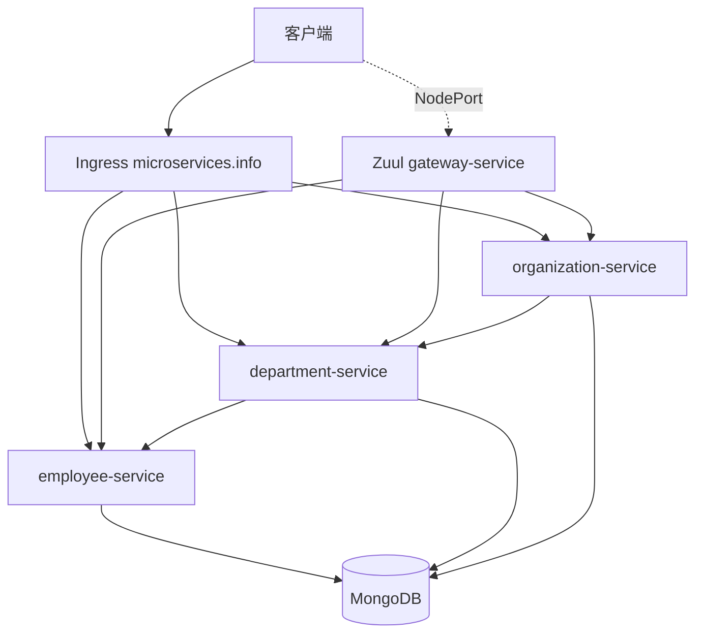
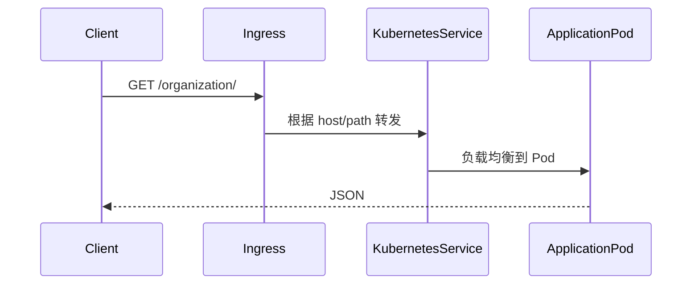

# Kubernetes 微服务部署示例

## Demo 目标

本示例展示如何把 Employee、Department、Organization 和 Gateway 部署到 Kubernetes，并让平台承担服务命名与流量入口职责：

- Deployment 管理应用副本；
- Service 提供稳定的集群内 DNS；
- Ingress 通过 `microservices.info` 暴露路径；
- MongoDB 为三个业务服务提供持久化；
- Zuul Gateway 提供应用层路由；
- Spring Cloud Kubernetes 读取集群服务信息。

## 架构



与 `master` 不同，本示例不运行 Eureka 和 Config Server。Kubernetes Service 名称充当稳定地址，部署参数通过清单和环境变量注入。

## 资源与代码对应关系

| 资源 | 作用 |
| --- | --- |
| `kubernetes/mongodb-deployment.yaml` | MongoDB 工作负载与服务 |
| `kubernetes/employee-deployment.yaml` | Employee Deployment/Service |
| `kubernetes/department-deployment.yaml` | Department Deployment/Service |
| `kubernetes/organization-deployment.yaml` | Organization Deployment/Service |
| `kubernetes/gateway-deployment.yaml` | Zuul Gateway Deployment/Service |
| `kubernetes/ingress.yaml` | `microservices.info` 的外部路径入口 |
| 各模块 `Dockerfile` | 构建应用镜像 |

Gateway 的 `application.yml` 把 `/employee/**`、`/department/**` 和 `/organization/**` 映射到对应服务。业务服务使用 MongoDB URI 保存数据，而不是主线 demo 的内存仓库。



当前 `ingress.yaml` 直接指向三个业务 Service，并不经过 Gateway；Gateway 以 NodePort 单独暴露，用于演示 Zuul 路由。两者是两种可对照的入口。

## 前置条件

- 一个可用的 Kubernetes 集群；
- `kubectl` 已指向目标上下文；
- 集群中已安装并配置 Ingress Controller；
- 清单引用的 `piomin/*:1.0` 镜像可拉取，或者已将自建镜像名写回清单；
- 若自行构建镜像，需要与这个 Spring Boot 2.0 快照兼容的 JDK/Maven 和 Docker。

## 构建镜像

每个服务目录均有 Dockerfile。先构建 Maven 包，再构建镜像；下面以 Employee 为例：

```shell
cd employee-service
mvn clean package
docker build -t <registry>/employee:1.0 .
```

其余三个模块同理。推送镜像后，把 `kubernetes/*-deployment.yaml` 中的 `image` 改为实际地址。若 Dockerfile 的基础镜像在当前网络拉取较慢，可在镜像名前添加：

```text
swr.cn-north-4.myhuaweicloud.com/ddn-k8s/docker.io/
```

## 部署

先部署 MongoDB，再部署业务服务和 Gateway，最后创建 Ingress：

```shell
kubectl apply -f kubernetes/mongodb-deployment.yaml
kubectl apply -f kubernetes/employee-deployment.yaml
kubectl apply -f kubernetes/department-deployment.yaml
kubectl apply -f kubernetes/organization-deployment.yaml
kubectl apply -f kubernetes/gateway-deployment.yaml
kubectl apply -f kubernetes/ingress.yaml
```

查看状态：

```shell
kubectl get pods
kubectl get services
kubectl get ingress
```

早期 Spring Cloud Kubernetes 客户端可能需要读取 Service/Endpoint 的权限。只在隔离的学习集群中按需授权，并优先创建最小权限 Role，而不是授予全局管理员：

```shell
kubectl create clusterrolebinding demo-cluster-reader \
  --clusterrole=cluster-reader \
  --serviceaccount=default:default
```

## 访问与验证

取得 Ingress 地址并添加本地域名解析：

```shell
kubectl get ingress
```

将 `<ingress-ip> microservices.info` 加入 hosts 文件后测试：

```shell
curl http://microservices.info/employee/
curl http://microservices.info/department/
curl http://microservices.info/organization/
```

若失败，按入口到后端的顺序排查：

```shell
kubectl describe ingress
kubectl get endpoints
kubectl logs deployment/gateway
```

## 已知限制

- 清单使用历史 Kubernetes API（例如 `extensions/v1beta1` Ingress），新集群可能拒绝创建，需要迁移到 `networking.k8s.io/v1`；
- 镜像名称是原作者发布的历史标签，不保证持续可用；
- MongoDB 凭据与存储配置仅用于演示，生产环境应使用 Secret、PVC、备份和高可用方案；
- 示例中的宽权限命令不适合生产环境。

## 阅读建议

先看 `kubernetes/*.yaml` 理解平台资源，再看 Gateway 路由与业务服务 `application.yml`，最后追踪 Organization → Department → Employee 的调用。与 [OpenShift 示例](../openshift/readme.md) 对比，可观察通用 Kubernetes 清单和 S2I 平台构建的差异。

返回[示例总览](../../README.md)。
