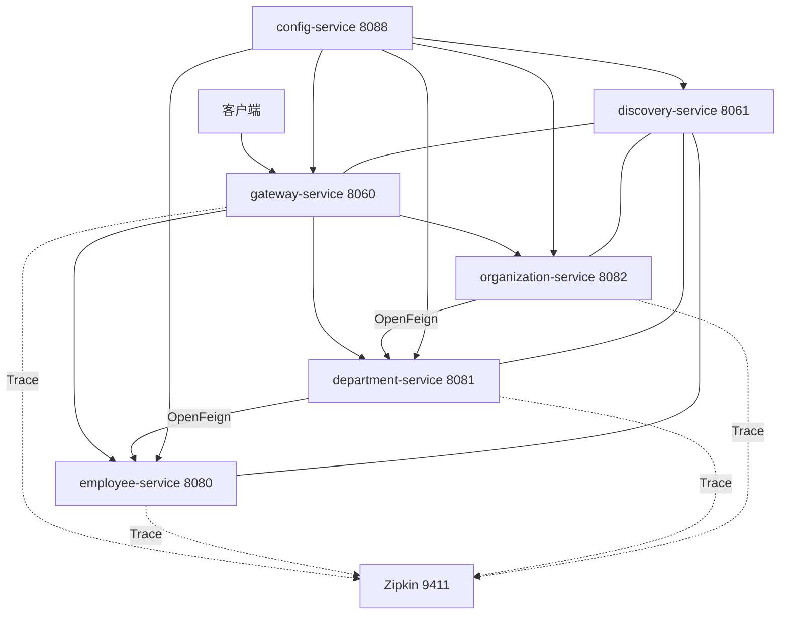
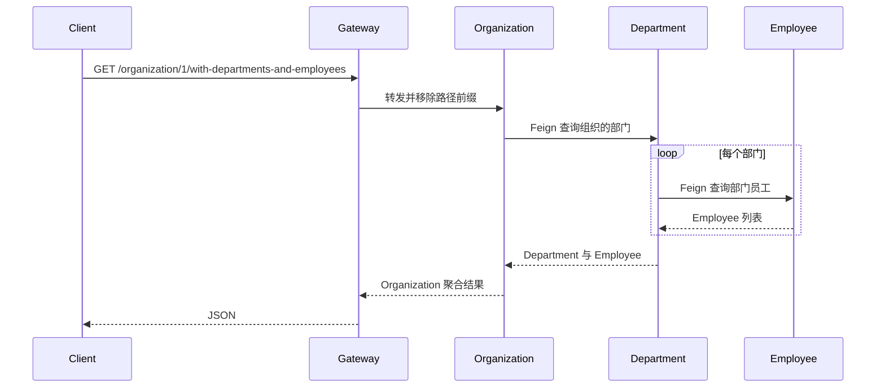

# Spring Cloud 微服务完整示例

## Demo 目标

本示例回答的是：**用 Config、Eureka、Gateway、OpenFeign、Springdoc 和 Zipkin 串起一条可运行的微服务调用链。** 领域仍是 Organization → Department → Employee，重点是基础设施如何协作，而不是业务 CRUD。

要验证的几件事：

1. **配置先于服务**：Config Server 能按 `{application}/{profile}` 下发 YAML，Compose 在配置中心健康后再启 Eureka。
2. **按服务名发现与路由**：业务服务和网关注册到 Eureka；Gateway 用 `lb://` 转发，而不是写死主机。
3. **跨服务聚合**：`GET /organization/1/with-departments-and-employees` 一次请求打通 Gateway → Organization → Department → Employee。
4. **文档与追踪统一入口**：网关聚合三份 OpenAPI；同一请求的 `traceId` 出现在各服务日志和 Zipkin 中。

当前代码基于 **Java 25、Spring Boot 4.1.1、Spring Cloud 2025.1.3**。网关是响应式 Spring Cloud Gateway，不是旧文章里的 Zuul。

## 架构与请求流



一次聚合查询会跨越三个业务服务：



## 模块说明

| 模块 | 职责 | 关键实现 |
| --- | --- | --- |
| `config-service` | Native 模式配置中心 | 配置位于 `src/main/resources/config/` |
| `discovery-service` | Eureka Server | 向客户端提供服务实例列表 |
| `gateway-service` | 统一路由与 OpenAPI 聚合 | `lb://` 路由、`RewritePath`、Springdoc |
| `employee-service` | 员工数据与查询接口 | 内存仓库、Spring MVC |
| `department-service` | 部门查询并聚合员工 | `@FeignClient` 调用 employee |
| `organization-service` | 组织查询并聚合部门与员工 | `@FeignClient` 调用 department |

## 如何实现

### 1. 配置先于服务启动

`config-service` 使用 classpath native 配置。Docker 场景通过 `*-docker.yml` 把 `localhost` 替换成 Compose 服务名。Compose 的健康检查先请求 `/employee/docker`，配置中心可用后才启动 Eureka。

### 2. 网关按服务名路由

`config-service/src/main/resources/config/gateway-service.yml` 为三个业务前缀配置 `lb://employee-service` 等 URI，并用 `RewritePath` 去掉 `/employee`、`/department`、`/organization` 前缀。`lb://` 会通过 Eureka 选择实例，而不是把主机地址写死。

### 3. 服务间逐层聚合

Organization 只依赖 Department 的客户端，Department 再依赖 Employee 的客户端。这种设计清楚地展示了级联调用，也便于在 Zipkin 中观察父子 Span；实际生产系统还应考虑超时、重试、熔断和避免 N+1 调用。

### 4. 文档与追踪统一入口

网关把 `/v3/api-docs/{service}` 重写为目标服务的 `/v3/api-docs`，Swagger UI 因而能切换查看三个服务。Docker profile 将 Zipkin 导出端点设为 `http://zipkin:9411/api/v2/spans`，日志格式同时打印 `traceId` 与 `spanId`。

## 运行方式

### 前置条件

- Docker 与 Docker Compose 插件；
- 首次构建需要访问 Maven 依赖仓库和容器镜像仓库；
- 本地 Maven 运行需要 JDK 25 与 Maven。

工作目录：`demos/master`。

### 推荐：Docker Compose

```shell
docker compose up --build
```

Compose 会按“Zipkin/Config → Eureka → 业务服务 → Gateway”的依赖关系启动。查看状态与停止：

```shell
docker compose ps
docker compose down
```

### 本地 Maven

在不同终端依次启动：

```shell
cd config-service && mvn spring-boot:run
cd discovery-service && mvn spring-boot:run
cd employee-service && mvn spring-boot:run
cd department-service && mvn spring-boot:run
cd organization-service && mvn spring-boot:run
cd gateway-service && mvn spring-boot:run
```

业务服务在本地 profile 下可使用动态端口；请从 Eureka 页面确认实际实例地址。Zipkin 是可选项，可单独启动：

```shell
docker run --rm -p 9411:9411 swr.cn-north-4.myhuaweicloud.com/ddn-k8s/docker.io/openzipkin/zipkin
```

## 验证

下面按“先基础设施，再单服务，再聚合，最后文档与追踪”的顺序做。Compose 使用表中地址；本地 Maven 时业务服务端口以 Eureka 为准，网关仍是 `8060`。

### 1. 配置中心可用

```shell
curl http://localhost:8088/employee/docker
```

应返回 employee 的 Docker profile YAML（含 `server.port`、Eureka 地址等）。本地 Maven 可改拉 `http://localhost:8088/employee/default`。

### 2. Eureka 中已注册网关和三个业务服务

打开 <http://localhost:8061>。`Application` 列表中应有 `GATEWAY-SERVICE`、`EMPLOYEE-SERVICE`、`DEPARTMENT-SERVICE`、`ORGANIZATION-SERVICE`，状态 `UP`。

若刚启动就访问网关得到 503，多半是实例还在注册，稍等再试。

### 3. 经网关访问单个服务

```shell
curl http://localhost:8060/employee/
curl http://localhost:8060/department/
curl http://localhost:8060/organization/
```

员工列表应含 `John Smith`、`Darren Hamilton` 等；组织列表应含 `Microsoft`、`Oracle`。这能说明 Gateway 的前缀剥离和 `lb://` 转发已生效。

### 4. 跨服务聚合（本 Demo 主路径）

```shell
curl http://localhost:8060/organization/1/with-departments-and-employees
```

**通过标准：** JSON 顶层为组织 1（`name` 为 `Microsoft`），`departments` 中含 `Development` 与 `Operations`，各部门 `employees` 下再嵌员工（Development 下应能看到 `John Smith`）。说明 Feign 级联已打通。

### 5. 网关聚合 OpenAPI

打开 <http://localhost:8060/swagger-ui.html>，应能在文档下拉框中切换 employee / department / organization。也可：

```shell
curl -s -o /dev/null -w "%{http_code}\n" http://localhost:8060/v3/api-docs/employee
```

应返回 `200`。

### 6. Trace 跨服务传播

再请求一次聚合接口，然后：

1. 打开 <http://localhost:9411>，按 `gateway-service` 或 `organization-service` 检索，应看到一条跨越多个 Span 的 Trace。
2. 对照各服务控制台日志中的 `[traceId,spanId]`，同一请求的 `traceId` 应一致。

## 已知限制

- 数据在内存中，重启即丢失；适合演示，不是持久化方案。
- 聚合接口存在 N+1 Feign 调用，教学用，生产需超时、重试和批量查询。
- 采样率设为 `1.0`，仅适合本地观察。

## 延伸阅读

- [项目原始文章：Quick Guide to Microservices with Spring Boot, Eureka and Spring Cloud](https://piotrminkowski.com/2018/04/26/quick-guide-to-microservices-with-spring-boot-2-0-eureka-and-spring-cloud/)
- [可观测性补充笔记](observability-notes.md)
- 返回[示例总览](../../README.md)
