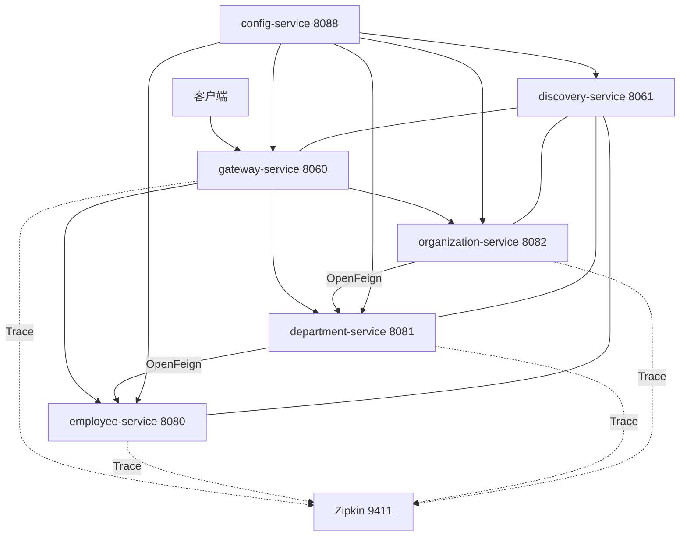
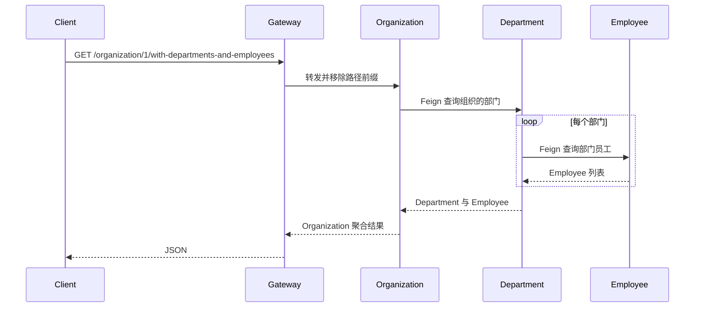

# Spring Cloud 微服务完整示例

## Demo 目标

本示例用一个可运行的系统串起微服务最常见的基础能力：

- Config Server 集中保存各服务配置；
- Eureka 完成服务注册与发现；
- Spring Cloud Gateway 提供统一入口和基于服务名的负载均衡；
- OpenFeign 实现 Organization → Department → Employee 的跨服务聚合；
- Springdoc 在网关聚合三个业务服务的 OpenAPI 文档；
- Micrometer Tracing 将 Trace 发送到 Zipkin。

当前代码基于 Java 25、Spring Boot 4.1.1 和 Spring Cloud 2025.1.3。它不是旧文章中基于 Zuul 的实现；网关已经迁移到响应式 Spring Cloud Gateway。

## 架构与请求流



一次聚合查询会跨越三个业务服务：



## 模块说明

| 模块 | 职责 | 关键实现 |
| --- | --- | --- |
| `config-service` | Native 模式配置中心 | 配置位于 `src/main/resources/config/` |
| `discovery-service` | Eureka Server | 向客户端提供服务实例列表 |
| `gateway-service` | 统一路由与 OpenAPI 聚合 | `lb://` 路由、`RewritePath`、Springdoc |
| `employee-service` | 员工数据与查询接口 | 内存仓库、Spring MVC |
| `department-service` | 部门查询并聚合员工 | `@FeignClient` 调用 employee |
| `organization-service` | 组织查询并聚合部门与员工 | `@FeignClient` 调用 department |

## 如何实现

### 1. 配置先于服务启动

`config-service` 使用 classpath native 配置。Docker 场景通过 `*-docker.yml` 把 `localhost` 替换成 Compose 服务名。Compose 的健康检查先请求 `/employee/docker`，配置中心可用后才启动 Eureka。

### 2. 网关按服务名路由

`config-service/src/main/resources/config/gateway-service.yml` 为三个业务前缀配置 `lb://employee-service` 等 URI，并用 `RewritePath` 去掉 `/employee`、`/department`、`/organization` 前缀。`lb://` 会通过 Eureka 选择实例，而不是把主机地址写死。

### 3. 服务间逐层聚合

Organization 只依赖 Department 的客户端，Department 再依赖 Employee 的客户端。这种设计清楚地展示了级联调用，也便于在 Zipkin 中观察父子 Span；实际生产系统还应考虑超时、重试、熔断和避免 N+1 调用。

### 4. 文档与追踪统一入口

网关把 `/v3/api-docs/{service}` 重写为目标服务的 `/v3/api-docs`，Swagger UI 因而能切换查看三个服务。Docker profile 将 Zipkin 导出端点设为 `http://zipkin:9411/api/v2/spans`，日志格式同时打印 `traceId` 与 `spanId`。

## 运行方式

### 前置条件

- Docker 与 Docker Compose 插件；
- 首次构建需要访问 Maven 依赖仓库和容器镜像仓库；
- 本地 Maven 运行需要 JDK 25 与 Maven。

### 推荐：Docker Compose

```shell
docker compose up --build
```

Compose 会按“Zipkin/Config → Eureka → 业务服务 → Gateway”的依赖关系启动。查看状态与停止：

```shell
docker compose ps
docker compose down
```

### 本地 Maven

在不同终端依次启动：

```shell
cd config-service && mvn spring-boot:run
cd discovery-service && mvn spring-boot:run
cd employee-service && mvn spring-boot:run
cd department-service && mvn spring-boot:run
cd organization-service && mvn spring-boot:run
cd gateway-service && mvn spring-boot:run
```

业务服务在本地 profile 下可使用动态端口；请从 Eureka 页面确认实际实例地址。Zipkin 是可选项，可单独启动：

```shell
docker run --rm -p 9411:9411 swr.cn-north-4.myhuaweicloud.com/ddn-k8s/docker.io/openzipkin/zipkin
```

## 验证

| 检查项 | 地址或命令 | 预期 |
| --- | --- | --- |
| 配置中心 | `curl http://localhost:8088/employee/docker` | 返回 employee 的 Docker profile 配置 |
| 服务注册 | <http://localhost:8061> | Eureka 中出现网关和三个业务服务 |
| 普通查询 | `curl http://localhost:8060/employee/` | 返回初始员工列表 |
| 聚合查询 | `curl http://localhost:8060/organization/1/with-departments-and-employees` | 返回嵌套的组织、部门和员工 |
| API 文档 | <http://localhost:8060/swagger-ui.html> | 可切换三个业务服务 |
| 调用链 | <http://localhost:9411> | 可按服务或 Trace 检索调用链 |

如果 Eureka 已启动但网关立即返回 503，通常是业务实例仍在注册或尚未通过健康检查，稍后重试并查看 `docker compose logs <service>`。

## 延伸阅读

- [项目原始文章：Quick Guide to Microservices with Spring Boot, Eureka and Spring Cloud](https://piotrminkowski.com/2018/04/26/quick-guide-to-microservices-with-spring-boot-2-0-eureka-and-spring-cloud/)
- [可观测性补充笔记](observability-notes.md)
- 返回[示例总览](../../README.md)

