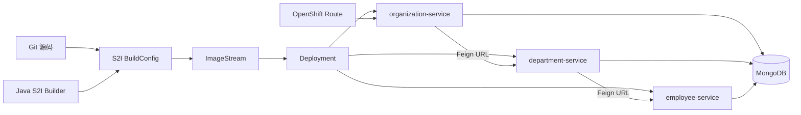
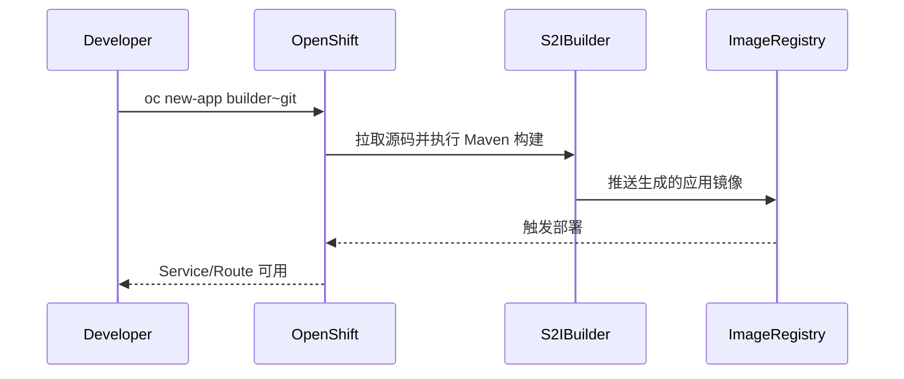

# OpenShift Source-to-Image 微服务示例

## Demo 目标

本示例回答的是：**源码如何在 OpenShift 内变成可运行服务，以及没有 Eureka 时如何用平台 Service DNS + 环境变量做服务间调用。** 重点是 S2I 与平台组网，不是注册中心或网关。

要验证的几件事：

1. **S2I 能从本目录源码构建出三个应用镜像**，Pod 进入 Running。
2. **Feign URL 来自环境变量**：`EMPLOYEE_SERVICE` / `DEPARTMENT_SERVICE` 解析为 OpenShift Service 名，而不是 Eureka。
3. **MongoDB 持久化且启动为空**：必须先 POST，再测聚合；控制器带 `/employee`、`/department`、`/organization` 前缀。
4. **Route 能从集群外访问** Organization（或其它已 expose 的服务）。

## 架构



## 与服务发现方案的区别

这里没有 Eureka、Nacos 或 Config Server。Feign Client 的目标 URL 来自应用配置：

```yaml
microservices:
  employee:
    url: http://${EMPLOYEE_SERVICE}:8080
  department:
    url: http://${DEPARTMENT_SERVICE}:8080
```

部署时把变量设为 OpenShift Service 的 DNS 地址。平台 Service 保持名称稳定，并将请求分发到后端 Pod。这种方式简单直接，但调用方需要明确知道依赖服务的配置键。

与 [`kubernetes`](../kubernetes/readme.md) 的差异：本目录 **没有** Gateway / Ingress YAML；API **带** `/employee` 等前缀；组织/部门/员工的关联 id 均为 **String**，更适合把 Mongo 生成的 id 串起来做聚合。

## 模块

| 模块 | 作用 | 平台配置重点 |
| --- | --- | --- |
| `employee-service` | 员工 CRUD | MongoDB 连接 |
| `department-service` | 部门 CRUD、调用 Employee | `EMPLOYEE_SERVICE` |
| `organization-service` | 组织 CRUD、调用 Department | `DEPARTMENT_SERVICE` |
| `.s2i/environment` | S2I 构建参数 | `VERSION=1.0` |

## S2I 工作流程



S2I 的价值是开发者可以从源码创建应用，不必先维护 Dockerfile。平台统一 builder 镜像、构建日志、镜像存储与部署触发器。

## 前置条件

- OpenShift 或兼容的本地开发集群；
- 已安装并登录 `oc` CLI；
- 当前用户可以创建 BuildConfig、ImageStream、Deployment、Service 和 Route；
- 集群目录中有可用的 Java/Maven S2I builder（需能构建当前 Spring Boot 4.1 / Java 25 代码，或改为兼容的 builder）；
- 已部署名为 `mongodb` 的 MongoDB Service，并准备好数据库用户名、密码和库名（对应 `MONGO_DATABASE_USER`、`MONGO_DATABASE_PASSWORD`、`MONGO_DATABASE_NAME`）。

工作目录语义上对应 `demos/openshift`。

## 部署思路

创建项目：

```shell
oc login <cluster-url>
oc new-project spring-microservices-demo
```

然后分别为三个模块创建 S2I 应用。具体 builder 名称随 OpenShift 版本和集群目录而异：

```shell
oc new-app <java-s2i-builder>~<git-url> \
  --context-dir=demos/openshift/employee-service \
  --name=employee-service
```

对 Department 和 Organization 重复操作，并设置依赖 URL 和 MongoDB 参数：

```shell
oc set env deployment/department-service \
  EMPLOYEE_SERVICE=employee-service

oc set env deployment/organization-service \
  EMPLOYEE_SERVICE=employee-service \
  DEPARTMENT_SERVICE=department-service
```

Mongo 三个变量请按各模块 `application.yml` 设置，不要把真实密码写进仓库。对外暴露：

```shell
oc expose service organization-service
oc expose service employee-service
oc expose service department-service
oc get routes
```

## 验证

把 `<org>`、`<emp>`、`<dept>` 换成 `oc get routes` 得到的 HOST。

### 1. S2I 构建成功、Pod 就绪

```shell
oc get builds
oc logs buildconfig/employee-service
oc get pods
oc get svc
```

**通过标准：** 三个应用的 Build 为 Complete；对应 Pod Running；存在 `employee-service`、`department-service`、`organization-service`（以及 `mongodb`）Service。

### 2. 空库 + 带前缀的 REST

```shell
curl -s "http://<emp>/employee/"
curl -s "http://<org>/organization"
```

应返回空列表 `[]`，**不是** 404。路径必须带 `/employee`、`/organization` 前缀（这与 kubernetes demo 的根路径不同）。

### 3. 写入后聚合（本 Demo 业务验收）

先创建组织，记下返回的 `id`（Mongo 字符串），再创建部门与员工：

```shell
curl -s -H "Content-Type: application/json" \
  -d '{"name":"Microsoft","address":"Redmond"}' \
  "http://<org>/organization"

curl -s -H "Content-Type: application/json" \
  -d '{"organizationId":"<ORG_ID>","name":"Development"}' \
  "http://<dept>/department/"

curl -s -H "Content-Type: application/json" \
  -d '{"organizationId":"<ORG_ID>","departmentId":"<DEPT_ID>","name":"John Smith","age":34,"position":"Analyst"}' \
  "http://<emp>/employee/"
```

再测跨服务：

```shell
curl -s "http://<org>/organization/<ORG_ID>/with-departments-and-employees"
```

**通过标准：** 响应里组织名称是 `Microsoft`，`departments` 非空，部门下 `employees` 含 `John Smith`。若组织有数据但部门/员工为空，先查：

```shell
oc set env deployment/organization-service --list
oc set env deployment/department-service --list
oc logs deployment/organization-service
oc logs deployment/department-service
```

确认 `EMPLOYEE_SERVICE`、`DEPARTMENT_SERVICE` 与 Mongo 三变量，以及对应 Service 是否有 Endpoints。

### 4. 可选：单服务文档

`http://<emp>/swagger-ui/index.html` 应能打开 Employee 的 Springdoc（无网关聚合）。

## 已知限制

- 仓库没有完整 OpenShift Template，部署命令需要根据集群版本补充；
- 应用代码已升级到 Spring Boot 4.1.x 与 Springdoc；S2I builder 必须能编译当前 JDK，不能假定仍是旧的 Boot 2 builder；
- 示例不包含生产级 Secret、持久卷、探针、资源限制和高可用 MongoDB；
- 不应为了方便直接给 default ServiceAccount 授予集群管理员权限。

## 延伸阅读

- [Running Java Microservices on OpenShift using Source-to-Image](https://piotrminkowski.com/2019/01/08/running-java-microservices-on-openshift-using-source-2-image/)
- 对比 [Kubernetes 示例](../kubernetes/readme.md)
- 返回[示例总览](../../README.md)
