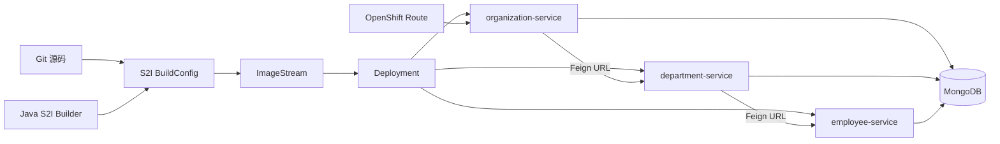
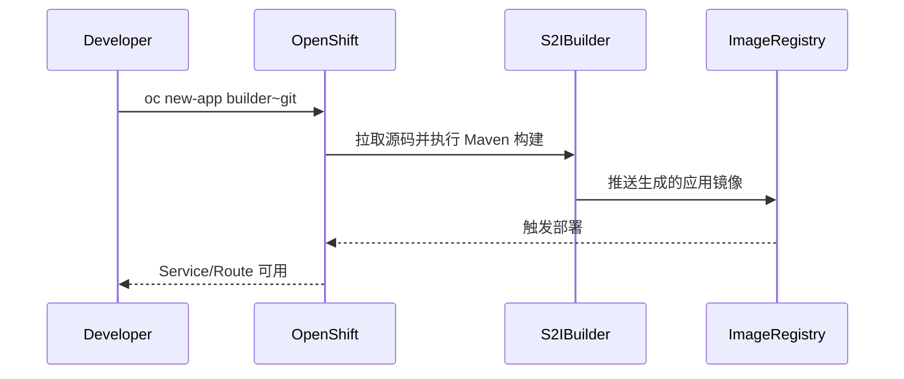

# OpenShift Source-to-Image 微服务示例

## Demo 目标

本示例关注“源码如何在 OpenShift 内变成可运行服务”，而不是注册中心或网关：

- Source-to-Image（S2I）在平台内编译 Spring Boot 源码并生成镜像；
- Employee、Department、Organization 分别部署为独立服务；
- 三个服务使用 MongoDB 持久化；
- OpenFeign 通过环境变量注入的服务 URL 通信；
- OpenShift Service 与 Route 提供内部寻址和外部访问。

## 架构



## 与服务发现方案的区别

这里没有 Eureka、Nacos 或 Config Server。Feign Client 的目标 URL 来自应用配置：

```yaml
microservices:
  employee:
    url: http://${EMPLOYEE_SERVICE}:8080
  department:
    url: http://${DEPARTMENT_SERVICE}:8080
```

部署时把变量设为 OpenShift Service 的 DNS 地址。平台 Service 保持名称稳定，并将请求分发到后端 Pod。这种方式简单直接，但调用方需要明确知道依赖服务的配置键。

## 模块

| 模块 | 作用 | 平台配置重点 |
| --- | --- | --- |
| `employee-service` | 员工 CRUD | MongoDB 连接 |
| `department-service` | 部门 CRUD、调用 Employee | `EMPLOYEE_SERVICE` |
| `organization-service` | 组织 CRUD、调用 Department | `DEPARTMENT_SERVICE` |
| `.s2i/environment` | S2I 构建参数 | 示例版本号等环境变量 |

## S2I 工作流程



S2I 的价值是开发者可以从源码创建应用，不必先维护 Dockerfile。平台统一 builder 镜像、构建日志、镜像存储与部署触发器。

## 前置条件

- OpenShift 或兼容的本地开发集群；
- 已安装并登录 `oc` CLI；
- 当前用户可以创建 BuildConfig、ImageStream、Deployment、Service 和 Route；
- 可访问与该 Spring Boot 2.0 项目兼容的 Java/Maven S2I builder；
- 已部署 MongoDB，并准备好数据库用户名、密码和服务地址。

## 部署思路

创建项目：

```shell
oc login <cluster-url>
oc new-project spring-microservices-demo
```

然后分别为三个模块创建 S2I 应用。具体 builder 名称随 OpenShift 版本和集群目录而异：

```shell
oc new-app <java-s2i-builder>~<git-url> \
  --context-dir=demos/openshift/employee-service \
  --name=employee-service
```

对 Department 和 Organization 重复操作，并设置依赖 URL 和 MongoDB 参数：

```shell
oc set env deployment/department-service \
  EMPLOYEE_SERVICE=employee-service

oc set env deployment/organization-service \
  EMPLOYEE_SERVICE=employee-service \
  DEPARTMENT_SERVICE=department-service
```

MongoDB 所需变量请以三个模块的 `application.yml` 为准设置，不要在清单或命令历史中提交真实密码。对需要外部访问的服务创建 Route：

```shell
oc expose service organization-service
oc get routes
```

## 验证与排错

```shell
oc get builds
oc logs buildconfig/employee-service
oc get pods
oc get services
oc get routes
```

取得 Route 后请求 Organization 接口，随后查看三项应用日志，确认 Feign 调用链：

```shell
curl http://<organization-route>/organization/
oc logs deployment/organization-service
```

若出现连接失败，先在 Pod 内确认 `EMPLOYEE_SERVICE`、`DEPARTMENT_SERVICE` 和 MongoDB 变量，再检查对应 Service 是否存在 Endpoint。

## 已知限制

- 仓库没有完整 OpenShift Template，部署命令需要根据集群版本补充；
- 应用代码已升级到 Spring Boot 4.1.x 与 Springdoc；OpenShift builder 名称与 S2I 流程需按当前集群目录调整；
- 示例不包含生产级 Secret、持久卷、探针、资源限制和高可用 MongoDB；
- 不应为了方便直接给 default ServiceAccount 授予集群管理员权限。

## 延伸阅读

- [Running Java Microservices on OpenShift using Source-to-Image](https://piotrminkowski.com/2019/01/08/running-java-microservices-on-openshift-using-source-2-image/)
- 对比 [Kubernetes 示例](../kubernetes/readme.md)
- 返回[示例总览](../../README.md)
