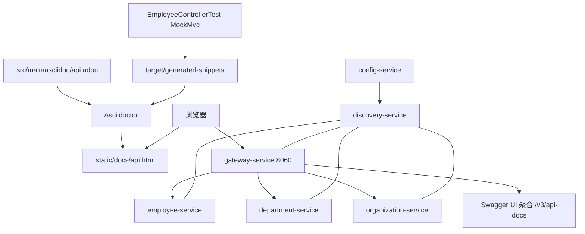

# Spring REST Docs 与 Springdoc 对比示例

## Demo 目标

本示例回答的是：**同一套 Employee API，测试驱动的静态文档和运行时 OpenAPI 各长什么样、分别怎么验收。** 调用链与 [`master`](../master/readme.md) 相同，差异在文档工具。

要验证的几件事：

1. **Spring REST Docs**：跑 `employee-service` 测试会在 `target/generated-snippets/` 留下请求/响应片段，Asciidoctor 产出静态 HTML。
2. **静态 HTML 随服务提供**：打包进 `static/docs/`，运行后可打开 `/docs/api.html`。
3. **Springdoc + Gateway 聚合**：Swagger UI 仍能切换三个业务服务的运行时文档。
4. **两种文档覆盖的操作不完全一样**：REST Docs 只覆盖 Employee 的「新增」和「按 id 查询」；列表、聚合、另两个服务只出现在 Springdoc 里。

已移除 Springfox 与 Zuul；栈为 **Java 25、Spring Boot 4.1.1、Spring Cloud 2025.1.3**。

## 架构



## 模块

| 模块 | 与文档相关的职责 |
| --- | --- |
| `employee-service` | REST Docs 测试、Asciidoctor、`/docs/api.html`；同时暴露 Springdoc |
| `department-service` / `organization-service` | 仅运行时 Springdoc |
| `gateway-service` | 聚合 `/v3/api-docs/{service}` 与 Swagger UI |
| `config-service` / `discovery-service` | 与 master 相同 |

## 运行方式

### 前置条件

- JDK 25 与 Maven（生成静态文档必须跑测试，**不要** `-DskipTests`）；
- 完整调用链可用 Docker Compose。

工作目录：`demos/rest-api-docs`。

### 方式一：只生成 Employee 静态文档

```shell
cd employee-service
mvn clean package
```

### 方式二：跑完整系统

```shell
docker compose up --build
```

注意：根目录 `Dockerfile` 使用 `mvn -B -DskipTests package`，**镜像里可能没有** REST Docs 生成的 `api.html`。要验收静态文档，用方式一的 JAR 本地启动 Employee，或修改镜像构建使测试不被跳过。

停止：

```shell
docker compose down
```

## 验证

### 1. REST Docs 片段由测试产生

在 `employee-service` 执行 `mvn clean package` 后检查：

- `target/generated-snippets/add-person/` 含 `http-request.adoc`、`request-fields.adoc`、`http-response.adoc`
- `target/generated-snippets/find-person-by-id/` 含 `path-parameters.adoc`、`response-fields.adoc` 等

**通过标准：** 这些目录在测试通过后出现；失败或 `-DskipTests` 时不会有完整片段。片段里的示例员工是测试 mock：`John Smith`，年龄 **33**，职位 **Developer**（与运行时种子数据的 34 / Analyst 不同，这是正常的）。

### 2. Asciidoctor 静态站点

同一构建应生成：

- `target/generated-docs/api.html`
- `target/classes/static/docs/api.html`

用浏览器打开后者，或本地启动 Employee 后访问：

```shell
cd employee-service && mvn spring-boot:run
```

打开 <http://localhost:8080/docs/api.html>（若本地端口被 Config 设为随机，以实际端口为准）。页面应有两节：**Add a new person**、**Find a person by id**，并嵌入上面的 HTTP 片段。

经网关时（需 Employee 镜像/进程里真的带上了 `static/docs`）：

<http://localhost:8060/employee/docs/api.html>

### 3. Springdoc 运行时文档（与 master 相同入口）

Compose 启动后打开 <http://localhost:8060/swagger-ui.html>，应能切换 employee / department / organization。

```shell
curl -s -o /dev/null -w "%{http_code}\n" http://localhost:8060/v3/api-docs/employee
curl -s -o /dev/null -w "%{http_code}\n" http://localhost:8060/v3/api-docs/department
```

均应 `200`。Swagger 里能看到列表、按部门查询、聚合等 REST Docs **没有**写成静态章节的接口。

### 4. 对照：调用链仍然可用

```shell
curl http://localhost:8060/employee/
curl http://localhost:8060/organization/1/with-departments-and-employees
```

运行时列表里的 `John Smith` 应为 34 岁 Analyst。这证明文档工具没有改业务行为；REST Docs 只是测试快照。

## 已知限制

- REST Docs 只覆盖 Employee 两个操作；Department / Organization 没有 Asciidoctor 手册。
- Compose/Dockerfile 默认 skipTests，容器内 `/docs/api.html` 可能 404。
- 测试 mock 与内存种子数据字段值不一致，对比文档和实时 API 时不要当成 bug。
- `proxy-service` 目录是历史残留，不参与构建。

## 延伸阅读

- 对照不带 REST Docs 的主线：[master](../master/readme.md)
- 返回[示例总览](../../README.md)
