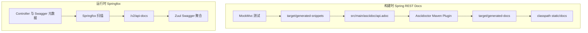
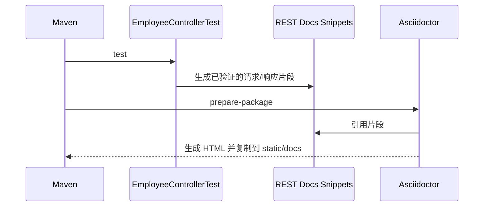
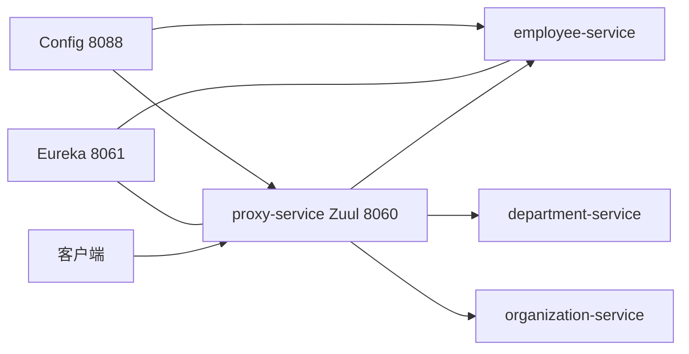

# Spring REST Docs 与 Springfox 对比示例

## Demo 目标

本示例在同一套微服务中实现两种 API 文档方案，帮助读者理解它们的取舍：

- Spring REST Docs 从通过的 MockMvc 测试生成请求、响应和字段片段；
- Asciidoctor 把人工说明与测试片段组合成静态 HTML；
- Springfox 在应用运行时扫描接口并生成 Swagger 描述；
- Zuul 可以聚合多个服务的 Swagger 文档。

核心问题不是“哪一个绝对更好”，而是文档可信度、编写成本、运行时依赖和交互体验之间如何权衡。

## 两条文档流水线



## Spring REST Docs 如何实现

`employee-service/src/test/java/.../EmployeeControllerTest.java` 使用：

- `@WebMvcTest(EmployeeController.class)` 只加载 Web 层；
- `@AutoConfigureRestDocs` 配置文档基础设施；
- `document(...)` 在断言通过后记录请求/响应；
- `requestFields`、`responseFields` 和 `pathParameters` 描述契约。

例如 `findPersonById` 必须先得到 200，才会生成响应字段和路径参数片段。接口行为变更但测试/文档未更新时，构建会失败，从而降低文档漂移风险。

`employee-service/src/main/asciidoc/api.adoc` 通过 `operation::...[]` 引入片段。`prepare-package` 阶段运行 Asciidoctor，并把 HTML 复制到应用的 `static/docs`。



## Springfox 如何实现

Employee 服务引入 `springfox-swagger2`，应用配置 API 标题和版本。运行时可从 `/v2/api-docs` 获取机器可读描述。`proxy-service` 实现 Swagger 资源聚合，并通过 Zuul 的服务路由访问各业务服务。

| 比较项 | Spring REST Docs | Springfox Swagger |
| --- | --- | --- |
| 数据来源 | 测试执行结果 | 运行时扫描 |
| 文档风格 | 人工编排的静态手册 | 交互式 API 描述 |
| 契约校验 | 测试失败会阻止生成 | 应用启动后才能检查 |
| 运行时依赖 | 生成后可不依赖工具 | 需要 Springfox |
| 维护重点 | 测试与 AsciiDoc | 注解、模型与扫描配置 |

## 系统模块

除 Employee 文档演示外，本目录还保留 Config Server、Eureka、Department、Organization、Spring Cloud Gateway 和 Zuul Proxy。`gateway-service` 与 `proxy-service` 都配置为 8060，因此它们是可选入口，不能按默认配置同时启动。



## 生成静态文档

### 前置条件

- JDK 8 和 Maven，或与 Spring Boot 2.0.0.RELEASE 兼容的环境；
- 首次构建可以访问历史 Maven 依赖。

只构建 Employee 文档：

```shell
cd employee-service
mvn clean package
```

重点检查：

```text
target/generated-snippets/
target/generated-docs/
target/classes/static/docs/
```

最终文件名由 `api.adoc` 与插件版本决定。打包后的文档位于 classpath `static/docs`，启动 Employee 后可通过 `/docs/` 路径访问。

## 运行 Swagger 方案

在不同终端依次运行：

```shell
cd config-service && mvn spring-boot:run
cd discovery-service && mvn spring-boot:run
cd employee-service && mvn spring-boot:run
cd department-service && mvn spring-boot:run
cd organization-service && mvn spring-boot:run
cd proxy-service && mvn spring-boot:run
```

验证 Employee 原始描述：

```shell
curl http://<employee-host>:<employee-port>/v2/api-docs
```

再从 Zuul/Swagger UI 查看聚合资源。实际 UI 路径和业务端口可能来自 Config Server，请以 `config-service/src/main/resources/config/` 与启动日志为准。

## 阅读建议

1. 运行 `EmployeeControllerTest`，查看 `target/generated-snippets`。
2. 阅读 `src/main/asciidoc/api.adoc`，理解人工内容如何引用自动片段。
3. 阅读 Employee POM 中 Asciidoctor 和 resources plugin 的 execution。
4. 查看 `EmployeeApplication` 的 Springfox 配置与 `/v2/api-docs`。
5. 查看 `proxy-service` 的 Swagger 资源聚合，再比较 `gateway-service` 的纯路由实现。

## 已知限制

- Springfox 2.8、Spring Boot 2.0 和 Finchley RC1 都是历史版本；
- 示例仅为 Employee 编写 REST Docs 测试，未覆盖全部服务；
- Gateway 与 Zuul 默认端口冲突；
- 生成文档的准确性只覆盖被测试和描述的场景，仍需维护边界条件与错误响应。

## 延伸阅读

- [Spring REST Docs versus Springfox Swagger for API documentation](https://piotrminkowski.com/2018/07/19/spring-rest-docs-versus-springfox-swagger-for-api-documentation/)
- 返回[示例总览](../../README.md)
