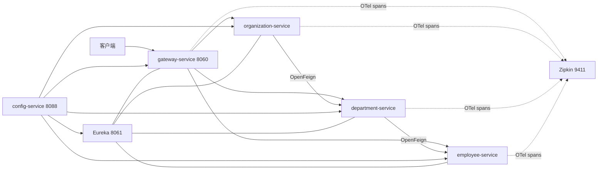
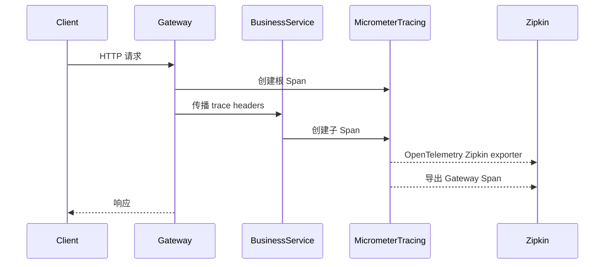

# Spring Boot 3 微服务、追踪与 API 文档

## Demo 目标

本示例展示 Spring Boot 3 技术栈中的完整微服务骨架，重点不是业务 CRUD，而是以下基础能力如何协作：

- Eureka 注册发现与 Config Server 集中配置；
- Spring Cloud Gateway 和 OpenFeign 的服务名调用；
- Micrometer Tracing、OpenTelemetry Bridge 与 Zipkin；
- Springdoc OpenAPI 文档及网关聚合；
- Spring Boot Buildpacks 构建 OCI 镜像。

代码基于 Java 21、Spring Boot 3.5.9 和 Spring Cloud 2025.0.0。领域仍是 Organization → Department → Employee，便于与 [`master`](../master/readme.md) 对照。

## 架构



追踪信息的产生和导出过程：



## 关键实现

### 服务发现与路由

`config-service/src/main/resources/config/gateway-service.yml` 使用 `lb://` URI 路由到三个业务服务，并移除入口路径前缀。OpenFeign 同样以 Eureka 中的 service ID 寻址，因此容器 IP 变化不会影响调用方。

### Micrometer Tracing

业务服务和网关引入 `micrometer-tracing-bridge-otel` 与 Zipkin exporter。Gateway 把追踪头传给下游，Feign 的 Micrometer 集成继续传播上下文。配置将采样率设为 `1.0`，适合教学；生产环境通常应降低采样率。

日志格式包含：

```text
[traceId,spanId] LEVEL message
```

可以从一条日志复制 `traceId` 到 Zipkin 检索完整调用链。

### Springdoc 聚合

各业务服务暴露 `/v3/api-docs`。网关把 `/v3/api-docs/{service}` 重写到相应服务，并在 Swagger UI 注册 employee、department、organization 三个文档源。

### 镜像构建

各模块的 `build-image` Maven profile 调用 Spring Boot 插件，由 Cloud Native Buildpacks 生成镜像。与 `master` 的多阶段 Dockerfile 不同，本目录的 `docker-compose.yml` 只引用镜像，不包含 `build:`。


## 模块

| 模块 | 作用 |
| --- | --- |
| `config-service` | Native Config Server，端口 8088 |
| `discovery-service` | Eureka Server，端口 8061 |
| `gateway-service` | Gateway、OpenAPI 聚合，端口 8060 |
| `employee-service` | 员工服务 |
| `department-service` | 部门服务，通过 Feign 聚合员工 |
| `organization-service` | 组织服务，通过 Feign 聚合部门 |

## 运行

### 前置条件

- JDK 21、Maven；
- Docker 与 Docker Compose 插件；
- 构建镜像时可访问 Maven 仓库和 Buildpacks builder/run 镜像。

### 构建并启动容器

先按各模块 POM 中的 `build-image` profile 生成 Compose 所需镜像：

```shell
mvn clean package -Pbuild-image
docker compose up
```

> 注意：`docker-compose.yml` 是历史快照，引用的部分镜像标签为 `1.1-SNAPSHOT`，部分为 `1.2-SNAPSHOT`。若本地构建得到的标签与清单不一致，请以各模块 `pom.xml` 的 `imageName` 为准同步调整清单，或直接使用下面的本地 Maven 方式。

停止环境：

```shell
docker compose down
```

### 本地 Maven 运行

在不同终端按顺序执行：

```shell
cd config-service && mvn spring-boot:run
cd discovery-service && mvn spring-boot:run
cd employee-service && mvn spring-boot:run
cd department-service && mvn spring-boot:run
cd organization-service && mvn spring-boot:run
cd gateway-service && mvn spring-boot:run
```

可选 Zipkin：

```shell
docker run --rm -p 9411:9411 swr.cn-north-4.myhuaweicloud.com/ddn-k8s/docker.io/openzipkin/zipkin
```

## 验证

1. 打开 <http://localhost:8061>，确认业务服务与 Gateway 已注册。
2. 请求聚合接口：

   ```shell
   curl http://localhost:8060/organization/1/with-departments-and-employees
   ```

3. 打开 <http://localhost:8060/swagger-ui.html>，切换不同服务的 OpenAPI 定义。
4. 连续调用接口后打开 <http://localhost:9411>，按 `gateway-service` 或业务服务检索 Trace。
5. 对照控制台日志中的 `traceId`，确认同一请求在 Gateway、Organization、Department 和 Employee 之间传播。

## 与 master 的区别

| 项目 | springboot3 | master |
| --- | --- | --- |
| Java / Spring Boot | Java 21 / Boot 3.5.9 | Java 25 / Boot 4.1.1 |
| Spring Cloud | 2025.0.0 | 2025.1.3 |
| 容器镜像 | Buildpacks profile | 多阶段 Dockerfile |
| Compose | 引用预构建镜像 | 从源码 `--build` |
| 学习重点 | Boot 3 追踪、Springdoc、Buildpacks | 当前主线的一键运行与新版本 API |

## 延伸阅读

- [Microservices with Spring Boot 3 and Spring Cloud](https://piotrminkowski.com/2023/03/13/microservices-with-spring-boot-3-and-spring-cloud/)
- 返回[示例总览](../../README.md)

