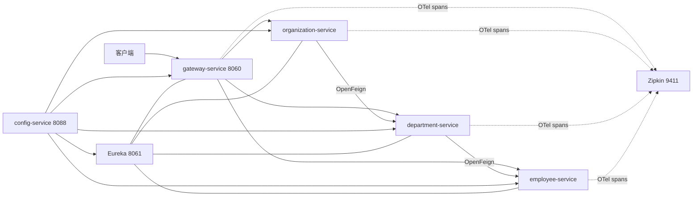
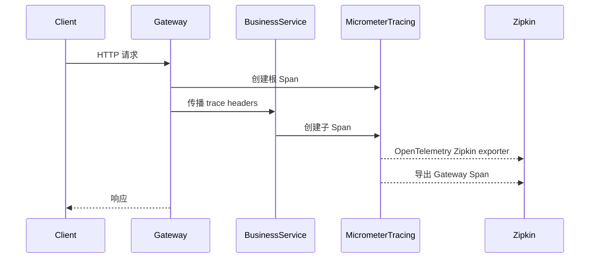

# Spring Boot 3 微服务、追踪与 API 文档

## Demo 目标

本示例回答的是：**在 Spring Boot 3 技术栈上，Config、Eureka、Gateway、OpenFeign、Micrometer Tracing 和 Springdoc 如何协作；镜像如何用 Buildpacks 构建。** 领域仍是 Organization → Department → Employee，便于对照 [`master`](../master/readme.md)。

要验证的几件事：

1. **Boot 3 调用链可跑通**：Eureka 注册 + Gateway `lb://` + Feign 聚合，与 master 业务路径相同。
2. **追踪是 Micrometer + OpenTelemetry，不是 Sleuth**：日志带 `traceId`/`spanId`，Zipkin 能看到跨 Gateway 与三个业务服务的 Trace。
3. **网关聚合 OpenAPI**：Swagger UI 可切换三个服务的文档。
4. **镜像来自 Buildpacks / Jib，而不是多阶段 Dockerfile**：Compose 只引用预构建镜像，不含 `build:`。

代码基于 **Java 21、Spring Boot 3.5.9、Spring Cloud 2025.0.0**。

## 架构



追踪信息的产生和导出过程：



## 关键实现

### 服务发现与路由

`config-service/src/main/resources/config/gateway-service.yml` 使用 `lb://` URI 路由到三个业务服务，并移除入口路径前缀。OpenFeign 同样以 Eureka 中的 service ID 寻址，因此容器 IP 变化不会影响调用方。

### Micrometer Tracing

业务服务和网关引入 `micrometer-tracing-bridge-otel` 与 Zipkin exporter。Gateway 把追踪头传给下游，Feign 的 Micrometer 集成继续传播上下文。配置将采样率设为 `1.0`，适合教学；生产环境通常应降低采样率。

日志格式包含：

```text
[traceId,spanId] LEVEL message
```

可以从一条日志复制 `traceId` 到 Zipkin 检索完整调用链。

### Springdoc 聚合

各业务服务暴露 `/v3/api-docs`。网关把 `/v3/api-docs/{service}` 重写到相应服务，并在 Swagger UI 注册 employee、department、organization 三个文档源。

### 镜像构建

各模块的 `build-image` Maven profile 调用 Spring Boot 插件或 Jib，由 Cloud Native Buildpacks / Jib 生成镜像。与 `master` 的多阶段 Dockerfile 不同，本目录的 `docker-compose.yml` 只引用镜像，不包含 `build:`。


## 模块

| 模块 | 作用 |
| --- | --- |
| `config-service` | Native Config Server，端口 8088 |
| `discovery-service` | Eureka Server，端口 8061 |
| `gateway-service` | Gateway、OpenAPI 聚合，端口 8060 |
| `employee-service` | 员工服务 |
| `department-service` | 部门服务，通过 Feign 聚合员工 |
| `organization-service` | 组织服务，通过 Feign 聚合部门 |

## 运行

### 前置条件

- JDK 21、Maven；
- Docker 与 Docker Compose 插件；
- 构建镜像时可访问 Maven 仓库和 Buildpacks builder/run 镜像。

工作目录：`demos/springboot3`。

### 构建并启动容器

先按各模块 POM 中的 `build-image` profile 生成 Compose 所需镜像：

```shell
mvn clean package -Pbuild-image
docker compose up
```

Compose 引用的镜像标签与模块版本一致：config / discovery / gateway 为 `piomin/*:1.1-SNAPSHOT`，三个业务服务为 `piomin/*:1.2-SNAPSHOT`。若本地构建得到的标签与清单不一致，请以各模块 `pom.xml` 的 `imageName` 为准同步调整清单，或直接使用下面的本地 Maven 方式。

业务服务容器**没有**把 8080 映射到固定宿主机端口，验证一律走网关 `8060`。

停止环境：

```shell
docker compose down
```

### 本地 Maven 运行

在不同终端按顺序执行：

```shell
cd config-service && mvn spring-boot:run
cd discovery-service && mvn spring-boot:run
cd employee-service && mvn spring-boot:run
cd department-service && mvn spring-boot:run
cd organization-service && mvn spring-boot:run
cd gateway-service && mvn spring-boot:run
```

可选 Zipkin：

```shell
docker run --rm -p 9411:9411 swr.cn-north-4.myhuaweicloud.com/ddn-k8s/docker.io/openzipkin/zipkin
```

## 验证

### 1. Eureka 注册

打开 <http://localhost:8061>，应出现 Gateway 与三个业务服务，状态 `UP`。

### 2. 单服务与聚合

```shell
curl http://localhost:8060/employee/
curl http://localhost:8060/organization/1/with-departments-and-employees
```

员工列表应含 `John Smith`。聚合结果顶层为 `Microsoft`，部门下嵌套员工。这与 master 的业务路径相同，用来证明 Boot 3 栈没有改掉调用链。

### 3. Springdoc 聚合（Boot 3 文档方案）

打开 <http://localhost:8060/swagger-ui.html>，切换 employee / department / organization。也可：

```shell
curl -s -o /dev/null -w "%{http_code}\n" http://localhost:8060/v3/api-docs/employee
```

应返回 `200`。

### 4. 本 Demo 重点：Trace 跨服务传播

连续调用聚合接口若干次：

```shell
curl -s http://localhost:8060/organization/1/with-departments-and-employees > /dev/null
```

**通过标准：**

1. 打开 <http://localhost:9411>，按 `gateway-service` 或 `organization-service` 检索，应看到跨越多个 Span 的 Trace（Gateway → Organization → Department → Employee）。
2. 从任一业务服务日志复制 `[traceId,spanId]` 中的 `traceId`，到 Zipkin 搜索，应命中同一条调用链。
3. 四个服务日志里同一请求的 `traceId` 应一致。这能说明传播靠的是 Micrometer Tracing / OTel，而不是旧的 Spring Cloud Sleuth。

## 与 master 的区别

| 项目 | springboot3 | master |
| --- | --- | --- |
| Java / Spring Boot | Java 21 / Boot 3.5.9 | Java 25 / Boot 4.1.1 |
| Spring Cloud | 2025.0.0 | 2025.1.3 |
| 容器镜像 | Buildpacks / Jib profile | 多阶段 Dockerfile |
| Compose | 引用预构建镜像；业务端口不映射到宿主机 | 从源码 `--build`；映射 8080/8081/8082 |
| 学习重点 | Boot 3 追踪、Springdoc、Buildpacks | 当前主线的一键运行与新版本 API |

## 已知限制

- Compose 不能 `docker compose up --build` 从源码直接出镜像，必须先 `mvn … -Pbuild-image`。
- 采样率 `1.0` 仅适合本地教学。
- 聚合接口同样存在 N+1 Feign 调用。

## 延伸阅读

- [Microservices with Spring Boot 3 and Spring Cloud](https://piotrminkowski.com/2023/03/13/microservices-with-spring-boot-3-and-spring-cloud/)
- 对照当前主线：[master](../master/readme.md)
- 返回[示例总览](../../README.md)
