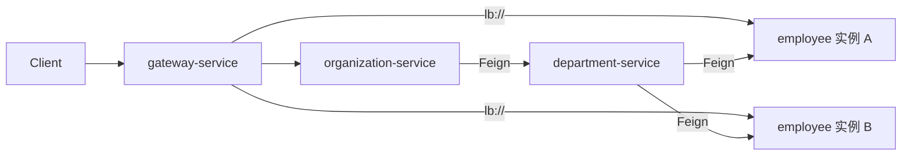

# 负载均衡在本 Demo 中的实现

本示例**没有**自写的负载均衡类或自定义 `LoadBalancer` 配置。客户端负载均衡由 **Spring Cloud LoadBalancer** 与 **Netflix Eureka** 在框架层完成：从注册中心拿到同一服务名的多个实例，每次调用选一个目标节点。

## 总览

| 场景 | 如何触发 | 均衡逻辑所在 |
| --- | --- | --- |
| 经 Gateway 访问业务 API | 路由 `uri: lb://服务名` | Spring Cloud Gateway + LoadBalancer |
| 服务间 HTTP 调用 | OpenFeign `@FeignClient(name = "服务名")` | OpenFeign + LoadBalancer |
| 实例列表来源 | 各业务服务注册到 Eureka | `discovery-service` |

默认算法为 Spring Cloud 自带的实现（常见为**轮询 RoundRobin**）。若要改为随机、加权等，需额外配置 `@LoadBalancerClient` 或自定义 `ReactorLoadBalancer`，本 Demo 未包含。

## 1. Gateway：`lb://` 路由

对外统一入口是 `gateway-service`。路由定义在 Config Server 中：

- 本地：`config-service/src/main/resources/config/gateway-service.yml`
- Docker：`config-service/src/main/resources/config/gateway-service-docker.yml`

关键片段：

```yaml
spring:
  cloud:
    gateway:
      server:
        webflux:
          discovery:
            locator:
              enabled: true
          routes:
            - id: employee-service
              uri: lb://employee-service
              predicates:
                - Path=/employee/**
            - id: department-service
              uri: lb://department-service
              predicates:
                - Path=/department/**
            - id: organization-service
              uri: lb://organization-service
              predicates:
                - Path=/organization/**
```

说明：

- **`lb://employee-service`**：`lb` 表示使用 LoadBalancer；主机名是 Eureka 中的 `spring.application.name`，不是固定 IP/端口。
- **`discovery.locator.enabled: true`**：启用基于服务发现的路由定位能力，与 Eureka 配合使用。
- Gateway 依赖 `spring-cloud-starter-netflix-eureka-client`，启动类使用 `@EnableDiscoveryClient`（见 `gateway-service/.../GatewayApplication.java`）。

多实例验证见 [readme](../readme.md) 中「第二套 employee-service（instance2）」：`EMPLOYEE-SERVICE` 在 Eureka 中出现 2 个实例时，对 `http://localhost:8060/employee/**` 的多次请求会落到不同进程。

## 2. 服务间调用：OpenFeign + 服务名

业务服务通过 Feign 按**逻辑服务名**调用，同样走 LoadBalancer。

| 调用方 | 客户端 | 目标服务名 |
| --- | --- | --- |
| `organization-service` | `EmployeeClient` | `employee-service` |
| `organization-service` | `DepartmentClient` | `department-service` |
| `department-service` | `EmployeeClient` | `employee-service` |

示例（`organization-service`）：

```java
@FeignClient(name = "employee-service")
public interface EmployeeClient { ... }
```

调用方 POM 中包含 `spring-cloud-starter-netflix-eureka-client` 与 `spring-cloud-starter-openfeign`，主类使用 `@EnableFeignClients`。Feign 解析 `employee-service` 时从 Eureka 取实例列表，再经 LoadBalancer 选择一台，**无需** `@LoadBalanced RestTemplate`（本仓库未使用）。

调用链示意（与 readme 架构图一致）：



## 3. 多实例如何注册到 Eureka

负载均衡生效的前提是：**同一 `spring.application.name` 下有多条健康实例**。

| 配置 | 文件 | 作用 |
| --- | --- | --- |
| 随机端口 | `config/employee-service.yml` 中 `server.port: 0` | 本机可起多个同名服务，真实端口以 Eureka 为准 |
| 唯一 instanceId | `eureka.instance.instanceId` 含 `${random.value}` | 第二实例不会覆盖第一个注册 |
| 第二实例固定端口 | `config/employee-service-instance2.yml`（9090） | 便于对照 Eureka 列表与网关分流 |

注册中心：`discovery-service`（Eureka Server，默认 `8061`）。

## 4. 与本 Demo 无关的部分

- **`proxy-service`**：历史 Zuul 残留，不参与当前 Gateway + `lb://` 方案。
- **Docker Compose 默认编排**：通常只有一个 `employee-service` 容器，不会自动起 9090 第二实例；多实例负载均衡验证更适合本机 Maven 或 Trampoline 方式。

## 相关文件索引

- Gateway 路由：`config-service/src/main/resources/config/gateway-service.yml`
- Gateway 应用：`gateway-service/src/main/java/pl/piomin/services/gateway/GatewayApplication.java`
- Feign 客户端：`organization-service/.../client/`、`department-service/.../client/EmployeeClient.java`
- 第二实例配置：`config-service/src/main/resources/config/employee-service-instance2.yml`
- 运行与验证步骤：[readme](../readme.md)
