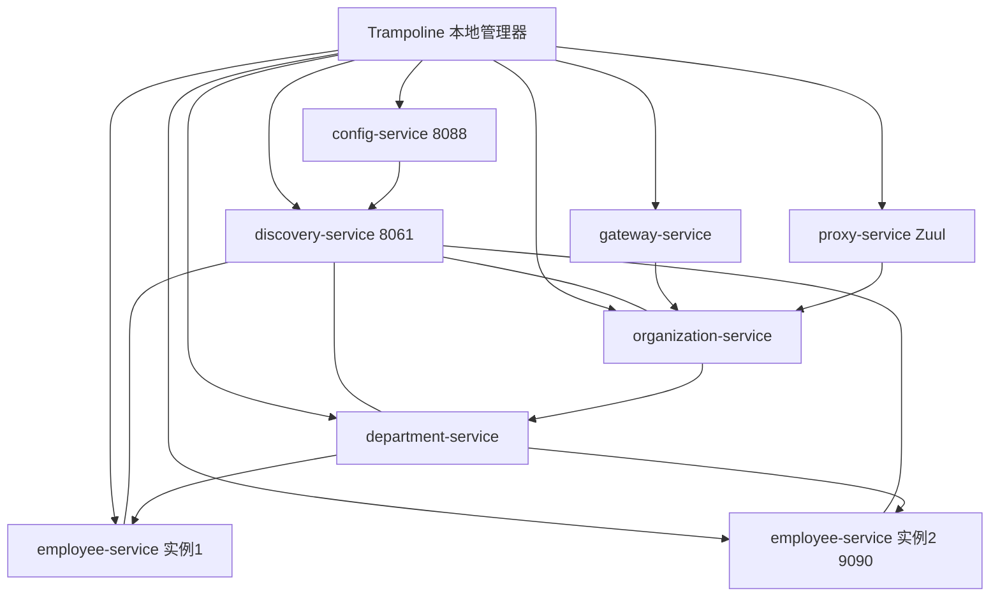
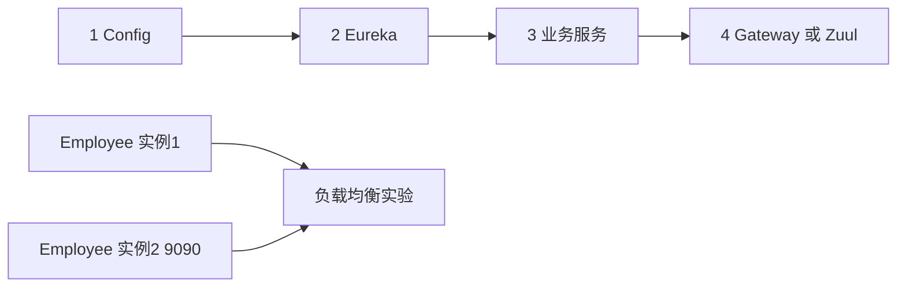

# 使用 Trampoline 管理本地微服务

## Demo 目标

当一个系统包含 Config、Eureka、多个业务服务和网关时，为每个应用打开终端、按顺序启动和查找日志会迅速变得繁琐。本示例通过 Trampoline 把多个 Spring Boot 进程放在同一个本地管理界面中，重点演示：

- 按依赖顺序批量启动和停止服务；
- 在统一界面查看每个应用状态与日志；
- 启动第二个 Employee 实例观察客户端负载均衡；
- 比较 Spring Cloud Gateway 与 Zuul 两种入口。

## 架构



Trampoline 只负责本地进程编排，不替代 Config Server、Eureka 或网关。各服务仍按普通 Spring Boot 应用运行。

## 模块

| 模块 | 职责 |
| --- | --- |
| `config-service` | 提供集中配置 |
| `discovery-service` | Eureka 注册中心 |
| `employee-service` | 员工服务，可启动多个实例 |
| `department-service` | 部门服务，调用 Employee |
| `organization-service` | 组织服务，调用 Department |
| `gateway-service` | Spring Cloud Gateway 入口 |
| `proxy-service` | Netflix Zuul 入口与 Swagger 聚合 |

`config-service/src/main/resources/config/employee-service-instance2.yml` 为第二个 Employee 实例设置 9090 端口。两个实例以同一个 service ID 注册后，Department 的调用可以在它们之间分配。

## 启动依赖



Config 必须先可用，因为其他应用会从它读取配置；Eureka 随后启动；业务服务注册成功后，最后启动入口服务。

## 使用方式

### 前置条件

- 与本历史项目兼容的 JDK 和 Maven；
- 安装 [Trampoline](http://ernestort.github.io/Trampoline/)；
- 本目录没有 Docker Compose，也没有提交 Trampoline 工作区配置，需要在工具中自行添加应用。

在 Trampoline 中为每个模块创建 Spring Boot 应用，工作目录指向对应模块，启动命令使用：

```shell
mvn spring-boot:run
```

建议建立四个启动组：

1. `config-service`
2. `discovery-service`
3. `employee-service`、`department-service`、`organization-service`
4. `gateway-service` 或 `proxy-service`

Gateway 和 Zuul 的配置可能使用同一入口端口，不应在没有修改端口的情况下同时启动。

### 不使用 Trampoline

也可以在不同终端按相同顺序手动运行：

```shell
cd config-service && mvn spring-boot:run
cd discovery-service && mvn spring-boot:run
cd employee-service && mvn spring-boot:run
cd department-service && mvn spring-boot:run
cd organization-service && mvn spring-boot:run
cd gateway-service && mvn spring-boot:run
```

第二个 Employee 实例使用 `instance2` profile，使 Config Server 读取 `employee-service-instance2.yml`：

```shell
cd employee-service
mvn spring-boot:run -Dspring-boot.run.profiles=instance2
curl http://localhost:8088/employee-service/instance2
```

## 验证

1. 在 Trampoline 中确认 Config 和 Eureka 先进入 Running。
2. 打开 <http://localhost:8061>，确认三个业务服务已注册。
3. 启动 Employee 第二实例后，确认 Eureka 中该 service ID 有两个实例。
4. 通过选定的 Gateway/Zuul 调用 Organization 聚合接口。
5. 多次调用并观察两个 Employee 进程日志，理解客户端负载均衡。
6. 停止其中一个 Employee 实例，观察 Eureka 摘除以及调用是否继续成功。

## Gateway 与 Zuul

| 入口 | 模块 | 特点 |
| --- | --- | --- |
| Spring Cloud Gateway | `gateway-service` | 响应式路由与过滤器模型 |
| Netflix Zuul | `proxy-service` | 旧版 Servlet 网关，包含 Swagger 聚合示例 |

这两个模块用于对照，不表示生产环境应该同时保留两个入口。

## 已知限制

- Trampoline 是外部历史工具，安装方式和兼容性以其项目文档为准；
- 仓库没有可直接导入的 Trampoline 配置；
- Spring Boot 2.0/Finchley 依赖较旧；
- 本地多实例示例没有生产级熔断、限流和持久化。

## 延伸阅读

- [Managing Spring Boot apps locally with Trampoline](https://piotrminkowski.com/2018/06/08/managing-spring-boot-apps-locally-with-trampoline/)
- 返回[示例总览](../../README.md)
