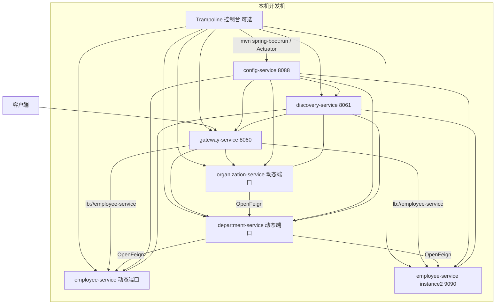

# 使用 Trampoline 管理本地微服务

## Demo 目标

本示例回答的不是“微服务怎么拆”，而是：**在本机同时跑 Config、Eureka、三个业务服务和 Gateway 时，如何把一堆 Spring Boot 进程管起来，并亲眼看到客户端负载均衡。**

要验证的三件事：

1. **本地多进程联调**：Config → Eureka → 业务服务 → Gateway 可以在本机按依赖顺序跑通，调用链与 [`master`](../master/readme.md) 相同。
2. **统一启停与看日志（可选）**：用 [Trampoline](http://ernestort.github.io/Trampoline/) 把多个服务注册成一组，在 Web 控制台里启动、停止、查看状态和日志，而不是开六个终端。
3. **同一服务的多实例负载均衡**：再起一个 `employee-service`（profile `instance2`，端口 **9090**），Eureka 中出现两个实例；Gateway 通过 `lb://employee-service` 把请求分到不同实例。

技术栈已对齐 **Java 25 / Spring Boot 4.1.1 / Spring Cloud 2025.1.3**，入口是 **Spring Cloud Gateway**（不是 Zuul）。Trampoline 只是本机进程管理工具，不替代注册中心或网关。

## 架构



本目录相对 `master` 的关键配置差异：

| 配置 | trampoline | 用意 |
| --- | --- | --- |
| 本地业务服务 `server.port: 0` | 随机端口 | 本机可同时起多个同名服务，真实端口以 Eureka 为准 |
| `eureka.instance.instanceId` 含随机值 | 多实例可并存 | 第二个 Employee 不会覆盖第一个注册 |
| `employee-service-instance2.yml` 固定 **9090** | 第二实例地址可预期 | 专门用来对照 Eureka 列表和网关分流 |
| `employee-service` 写 `logs/employee-service.log` | 落盘日志 | 便于 Trampoline / 本机 tail 日志 |

## 模块

| 模块 | 职责 | 本地端口 |
| --- | --- | --- |
| `config-service` | Native Config Server | 8088 |
| `discovery-service` | Eureka Server | 8061 |
| `gateway-service` | 统一入口、`lb://` 路由、OpenAPI 聚合 | 8060 |
| `employee-service` | 员工查询 | 动态；第二实例 9090 |
| `department-service` | 部门查询，Feign 调 employee | 动态 |
| `organization-service` | 组织查询，Feign 调 department / employee | 动态 |

## 运行方式

### 前置条件

- JDK 25 与 Maven（本机演示负载均衡必须用 Maven，Compose 只起一个 Employee）。
- 可选：Docker 与 Docker Compose 插件（一键跑通调用链）。
- 可选：[Trampoline](https://github.com/ErnestOrt/Trampoline)（本机分组启停；默认占用 8080，建议改 `server.port`）。

工作目录一律是 `demos/trampoline`。

### 方式一：Maven 本地（用来做本 Demo 的核心实验）

在不同终端按顺序启动：

```shell
cd config-service && mvn spring-boot:run
cd discovery-service && mvn spring-boot:run
cd employee-service && mvn spring-boot:run
cd department-service && mvn spring-boot:run
cd organization-service && mvn spring-boot:run
cd gateway-service && mvn spring-boot:run
```

业务服务本地 profile 使用随机端口，先打开 Eureka 确认实例地址，再发请求。

### 方式二：Trampoline 控制台（演示“统一管理进程”）

1. 克隆并启动 Trampoline（默认 `http://localhost:8080`，若冲突请改端口）：

   ```shell
   git clone https://github.com/ErnestOrt/Trampoline.git
   cd Trampoline/trampoline
   mvn spring-boot:run -Dspring-boot.run.arguments=--server.port=8099
   ```

2. 打开控制台，在 Maven Settings 中设置本机 `MAVEN_HOME`。
3. 在 SETTINGS 里把本目录各模块登记为 **本地 Git 路径**：填写服务名、端口、Actuator 路径（默认 `/actuator`）、构建工具 Maven、以及对应 `pom.xml` 路径。建议端口：Config `8088`、Eureka `8061`、Gateway `8060`；三个业务服务请指定固定端口（不要依赖 `server.port: 0`），否则控制台登记的端口和实际进程对不上。
4. 把六个服务放进同一个 Group。
5. 到 INSTANCES：先单独 Launch `config-service`，待 8088 可访问后再 Launch 整个 Group（或按 Config → Eureka → 业务服务 → Gateway 逐个启动）。Trampoline 不会等待依赖健康，组启动几乎同时执行。

### 方式三：Docker Compose（只验证调用链，不演示第二实例）

```shell
docker compose up --build
```

Compose 中每个业务服务只有一个容器，**不能**代替下面的负载均衡实验。停止：

```shell
docker compose down
```

## 验证

下面按“先确认基础设施，再确认业务，最后确认本 Demo 特有的多实例分流”的顺序做。本地 Maven 时把 `localhost` 换成 Eureka 里看到的实际端口；Compose / 固定端口网关则用 `8060`。

### 1. 配置中心可用

```shell
curl http://localhost:8088/employee/default
```

应返回 `employee-service.yml` 的 YAML（含 `server.port: 0` 等）。再拉第二实例配置：

```shell
curl http://localhost:8088/employee/instance2
```

应看到 `server.port: 9090`。

### 2. Eureka 中已注册网关和三个业务服务

打开 <http://localhost:8061>。`Application` 列表中应有 `GATEWAY-SERVICE`、`EMPLOYEE-SERVICE`、`DEPARTMENT-SERVICE`、`ORGANIZATION-SERVICE`，状态 `UP`。此时 `EMPLOYEE-SERVICE` 只有 **1** 个实例。

若刚启动就访问网关得到 503，多半是实例还在注册，稍等再试。

### 3. 经网关访问单个服务

```shell
curl http://localhost:8060/employee/
```

应返回内存中的员工列表（含 `John Smith`、`Darren Hamilton` 等）。部门、组织：

```shell
curl http://localhost:8060/department/
curl http://localhost:8060/organization/
```

组织列表中应能看到 `Microsoft`、`Oracle`。

### 4. 跨服务聚合（与 master 相同的调用链）

```shell
curl http://localhost:8060/organization/1/with-departments-and-employees
```

响应应是嵌套 JSON：组织 1（Microsoft）下有部门，部门内再嵌员工。说明 Gateway → Organization → Department → Employee 已打通。

可选：<http://localhost:8060/swagger-ui.html> 可切换三个业务服务的 OpenAPI。

### 5. 本 Demo 重点：第二个 Employee 实例与负载均衡

保持第一套服务运行，再开一个终端：

```shell
cd employee-service
mvn spring-boot:run -Dspring-boot.run.profiles=instance2
```

`instance2` 配置里 Eureka 地址是 `http://discovery-service:8061/eureka/`。本机若无法解析该主机名，把 `config-service/src/main/resources/config/employee-service-instance2.yml` 中的 `defaultZone` 临时改为 `http://localhost:8061/eureka/` 后重启 Config 与第二实例。

**通过标准：**

1. 刷新 Eureka：`EMPLOYEE-SERVICE` 变为 **2** 个实例，其中一个端口为 **9090**。
2. 多次请求网关，确认两个实例都能接到流量（内存仓库互不共享，列表内容相同但进程日志不同）：

   ```shell
   for i in 1 2 3 4 5 6; do curl -s -o /dev/null -w "%{http_code}\n" http://localhost:8060/employee/; done
   ```

   六个请求都应返回 `200`。同时观察两个 Employee 终端（或 `logs/employee-service.log`），`Employees fetched` 日志应分别出现在两个进程中，而不是只打在其中一个。
3. 停掉端口 9090 的进程后再刷 Eureka，实例数回到 1；网关请求仍应 `200`。这能说明 `lb://` 用的是注册表，而不是写死的单机地址。

### 6. Trampoline 是否真的在“管理”服务（仅方式二）

| 检查项 | 做法 | 预期 |
| --- | --- | --- |
| 组启动 | INSTANCES 中 Launch Group | 各服务进入 Running；Eureka 中陆续出现实例 |
| 监控 | 点击某实例的 metrics / logs | 能看到 Actuator 健康信息或日志 |
| 停止 | 对单个实例 Shutdown / Restart | 进程退出或重建；Eureka 短暂摘除后再注册 |

当前配置只暴露 `health` 与 `sbom`，**没有**打开 `/actuator/shutdown`。若 Trampoline 的 Shutdown 按钮无效，用控制台停进程或在终端 `Ctrl+C`，这不影响“分组启动”和 Eureka 验证。

## 已知限制

- Trampoline 是较旧的社区项目，对较新的 Spring Boot Actuator 路径、JDK 25 没有官方保证；本示例即使不用它，Maven / Compose 仍可完整演示调用链和负载均衡。
- Docker Compose 与 `master` 编排相同，只有一个 `employee-service` 容器，**不会**自动起 9090 第二实例。
- 本地默认 `server.port: 0` 与 Trampoline“登记固定端口”的模型不完全一致；用控制台管理时请为业务服务指定固定端口。
- `proxy-service` 目录是历史 Zuul 残留，不参与当前启动与验证。

## 延伸阅读

- [Managing Spring Boot apps locally with Trampoline](https://piotrminkowski.com/2018/06/08/managing-spring-boot-apps-locally-with-trampoline/)
- 对照完整调用链：[master](../master/readme.md)
- 返回[示例总览](../../README.md)
